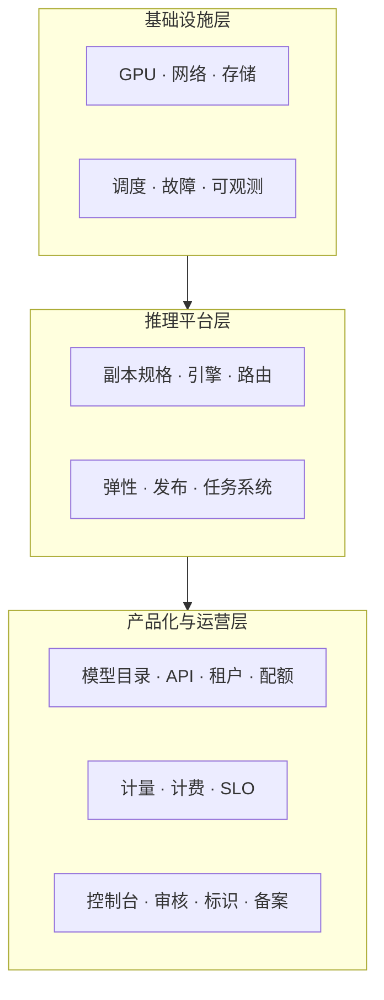

# 00 前言：这本书怎么用

> 这是一本设计书，不是产品手册。它记录"为什么这样设计"，以及"哪些结论还没有证据"。

## 0.1 为什么要写成书

这类平台的结论最容易出两个问题：一是**结论失去前提**（“用 llm-d”离开了
“多轮对话为主、前缀复用高”这个条件就不成立）；二是**决策无法追溯**（三个月后没人
记得为什么不上 PD 分离）。

把内容整理成书，目的不是显得完整，而是让每个结论都带三样东西：**前提、代价、复核时点**。

## 0.2 全书的一条主线

MaaS 的建设可以粗暴地分成三层：

- 下层决定**能不能跑**、**单位成本是多少**。
- 上层决定**能不能收钱**、**能不能过审**、**客户敢不敢用**。
- 两层之间只有一个契约：**部署规格 + 任务契约 + 计量事件**。本书反复回到这三个契约。

一个常见失败模式是：下层做得很深（PD 分离、KV 分层、混部），上层却只有一个 API Key
和一张手写账单。结果是技术很先进，商业上算不清账，也过不了合规。

## 0.3 三条阅读路径

| 你是谁 | 先读 | 再读 | 可以跳过 |
|---|---|---|---|
| 负责人 / 决策者 | 01、03、04、38 | 39 | 06~19 的实现细节 |
| 平台 / SRE | 05、06~13、14~19、36 | 37 | 28~32 的产品细节 |
| 产品 / 后端 | 02、20~27、28~32 | 34 | 10~13 的训练调度 |
| 合规 / 安全 | 04、33~35、附录 C | 28 | 17、18 的性能优化 |

## 0.4 本书不写什么

明确排除，避免读者期待错位：

- **Kubernetes 入门**。假设读者知道 Pod、Deployment、CRD、taint/toleration。
- **推理引擎源码解析**。只写"选型判据、适配成本、需要观测什么"。
- **商务合同与报价模板**。只写计价单位和成本模型。
- **具体厂商对比评测**。生态变化太快，写死会很快过期；只给判据和复核时点。
- **训练算法**。训练平台只作为推理平台的底座出现。

## 0.5 三个词先定义清楚

后文大量使用，混用会直接导致设计错误：

| 词 | 定义 | 调度单位 | 生命周期 |
|---|---|---|---|
| **副本（replica）** | 一个能独立对外服务的推理进程组，可能跨多卡甚至多机 | 调度原子 | 长驻，按弹性伸缩 |
| **实例（instance）** | 副本内部的一个进程/容器；单机多卡时一个副本含多个实例 | 不作为调度单位 | 随副本 |
| **任务（task）** | 一次具体的生成请求（一次对话、一张图、一段视频） | 队列单位 | 秒到分钟，可重试 |

一句话：**副本按规格调度，任务按队列调度，两者不要混在一个抽象里。**

## 0.6 事实分级

本书会出现三类内容，标记如下：

- 〔建议〕：蓝本给出的参考选择，可以采纳也可以推翻，推翻时记 ADR。
- 〔通行〕：业界当前通行做法，会随版本变化，落地前按当期文档复核。
- 〔核验〕：外部事实（法规条款、项目版本、第三方 API 规则），**上线或签约前必须核对原始来源**。

正文引用的版本号、发布时间、第三方计费与保留期，默认都是〔核验〕。附录 E 统一登记。

## 0.7 怎么用这本书推进项目

建议按"每章一个交付物"的方式推进，而不是读完再动手：

1. 读完第 01~05 章，产出一页纸定位、资源池图、架构图、合规约束表。
2. 每读完一篇，把该篇的「决策点」抄进自己的决策清单，开会拍板并记 ADR。
3. 附录 C 的检查清单直接作为上线 gate，不通过不上线。
4. 附录 E 的事实核验项，指定责任人和截止时间，逾期视为风险升级。

## 本章结论

- 本书的核心不是技术栈清单，而是**三个契约**：部署规格、任务契约、计量事件。
- 所有结论都要带前提；没有前提的结论，在规模变化时会变成负债。
- 先建"能算账"的最小闭环，再谈优化。

## 决策点（结合自身情况）

1. 你的团队更偏平台、产品还是合规？这决定阅读顺序与详略。
2. 是否接受"先 LLM、后图像、最后视频"的节奏？若不接受，第 38 章需重写。
