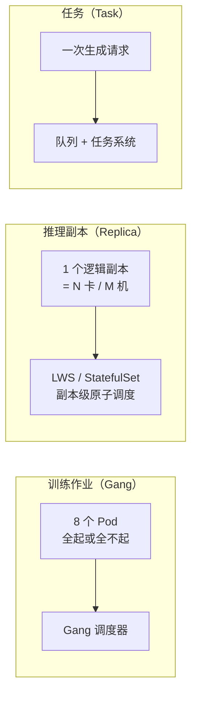

# 第 2 章 三类负载与两种时间尺度

> 训练按"天"调度，推理按"毫秒"响应，批处理按"小时"排队。把三者放进一个队列，
> 一定是其中两个被牺牲。

## 2.1 时间尺度决定架构

| 负载 | 典型时长 | 调度周期 | 失败代价 | 优化目标 |
|---|---|---|---|---|
| 训练 | 数小时 ~ 数周 | 分钟级（排队、抢占） | 高（丢进度） | 吞吐、利用率、稳定性 |
| 离线批处理 | 分钟 ~ 数小时 | 分钟级 | 低（可重跑） | 单位成本 |
| 在线 LLM 推理 | 数百毫秒 ~ 数分钟 | 秒级（扩缩容） | 低（可重试） | TTFT、TPOT、吞吐 |
| 图像生成 | 数秒 ~ 数十秒 | 秒级 | 中 | 等待时间、单张成本 |
| 视频生成 | 数分钟 ~ 数十分钟 | 分钟级（队列） | 高（重算贵） | 排队时长、完成率 |

关键矛盾：**调度周期比响应周期长一个数量级以上**。用分钟级的扩缩容去接毫秒级的流量，
只能靠预留容量；用在线队列去跑训练，会让 GPU 永远碎片化。这不是调参能解决的，
只能靠**分池 + 不同调度器**。

## 2.2 三类推理负载画像

| 维度 | LLM | 图像 | 视频 |
|---|---|---|---|
| 单次耗时 | 秒 ~ 分钟，流式输出 | 秒级 | 分钟级 |
| 交付方式 | SSE 流式 | 同步或短异步 | 异步任务 |
| GPU 占用 | 副本常驻，连续批处理共享 | 单请求可占满卡 | 单任务独占多卡 |
| 并行方式 | TP / EP / DP | 单卡为主，批量并行 | 多卡并行（序列/空间） |
| 弹性指标 | 队列深度、KV 使用率、TTFT | 队列长度、等待时间 | 预计排队时长、并发任务数 |
| 计量单位 | token（输入/输出/缓存） | 张 × 分辨率 × 质量档 | 秒 × 分辨率（含音频） |
| 失败重试成本 | 低 | 中 | 高（分钟级重算） |
| 抢占边界 | 请求边界 | 单张边界 | 任务边界或阶段检查点 |

这张表直接推出三个设计要求：

1. **LLM 的容量单位是并发与 token 速率**，不是"卡数"。
2. **图像的容量单位是张/小时**，弹性可以很激进，因为单次任务短。
3. **视频的容量单位是秒/小时**，且必须能"排队等"，不能承诺低延迟。

## 2.3 两种调度原子



- 训练作业用 **Gang**：部分启动等于浪费，必须全有或全无。
- 推理副本用 **副本级原子调度**：一个副本内多卡必须落在同一拓扑域，否则 TP 通信拖垮性能。
- 任务用 **队列**：任务不是调度单位，副本才是；任务只是副本的工作项。

三者混用会出现典型故障：把一个 8 卡推理副本当成 8 个独立 Pod 调度，结果 4 卡在机架 A、
4 卡在机架 B，TP 跨 Leaf 交换机，吞吐掉一半，而监控上"卡都在跑"。

## 2.4 为什么必须分池

| 理由 | 说明 |
|---|---|
| 显存 | 视频任务独占整卡，LLM 副本要常驻 KV 空间，抢显存等于互相 OOM |
| 网络 | 训练吃东西向带宽，推理吃南北向；混跑时训练把推理的 P99 拖垮 |
| SLO | 在线推理要稳定延迟，批处理要吞吐，目标函数不同 |
| 故障域 | 训练任务崩溃不应影响在线副本；反之亦然 |
| 计价 | 不同池的单位成本不同，混在一起无法归因 |

〔建议〕起步阶段设 **4 个资源池 + 1 条借还通道**：

| 池 | 用途 | 抢占策略 | 最小保留 |
|---|---|---|---|
| `pool-llm-online` | LLM 在线副本 | 不可被抢占 | 按 SLO 预留 |
| `pool-image` | 图像生成 | 可被在线抢占 | 低 |
| `pool-video` | 视频任务 | 可被在线/图像抢占（任务边界） | 0 |
| `pool-batch` | 离线批量、评测 | 最低优先级，随时可抢 | 0 |
| `borrow` | 低谷时把在线空闲卡借给 video/batch | 在线高峰时收回 | 动态 |

## 2.5 可借卡的三个边界条件

潮汐混部听起来很美，但只有满足以下三条才允许借：

1. **抢占点可控**：借出的负载必须在任务边界或检查点被中断。视频任务若无法在 30 秒内
   保存进度，就不允许借在线池的卡。
2. **归还足够快**：从决定收回到副本可服务，必须小于在线侧的扩容提前量（见第 18 章）。
   一个要 20 分钟才能腾空的训练任务，不适合做借出方。
3. **隔离足够硬**：显存、SM、网络带宽至少有一项能硬隔离。只靠 cgroup 限制 CPU
   不足以防止借出负载把在线副本的 P99 打穿。

不满足时，宁可让卡空转，也不要借。**空转的成本是可计算的，SLO 违约的成本不是。**

## 2.6 容量单位不能混

三种负载的容量单位不同，必须统一到一个"可换算的底"：

```
LLM:   token/s        → 卡时 = 副本卡数 / 实测 token 速率
图像:  张/小时         → 卡时 = 单张 GPU 秒 / 3600
视频:  秒/小时         → 卡时 = 生成 1 秒视频所需卡秒 / 3600
```

只有换算到**卡时**，才能做三件事：跨模态比较毛利、决定借卡给谁、做容量预测。
否则会出现"LLM 利用率 70%，视频利用率 20%，所以视频很浪费"这种错误结论——
视频的 20% 可能已经是排队满载，因为单任务独占多卡且耗时长。

## 本章结论

- 时间尺度差异决定了**必须分池**，且不同池用不同调度器与不同指标。
- 训练作业、推理副本、任务是三种不同原子，不能用一个抽象硬套。
- 潮汐混部的前提是"可中断、可快速归还、可硬隔离"，缺一不可。
- 所有容量最终换算成卡时，才能谈成本和优先级。

## 决策点（结合自身情况）

1. 四个池的初始卡数比例是多少？需要按首个付费客户的模态分布定。
2. 视频任务是否允许被在线池抢占？若允许，检查点粒度是多少？
3. 是否允许训练任务借在线池的卡？本书默认**不允许**，只允许 batch 与 video 借。
