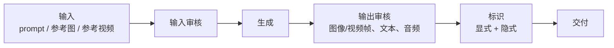
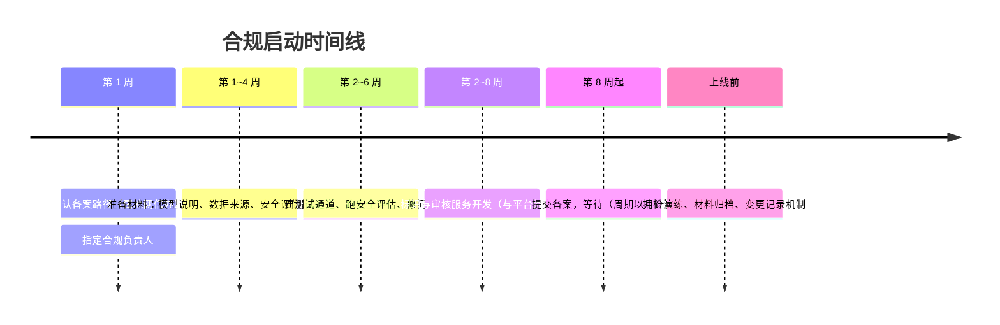

# 第 4 章 合规是架构约束，不是上线前的手续

> 备案要按月计，标识要写进文件字节，审核要长在管线里。三件事都无法"上线后补"。

> 本章只给工程约束，不构成法律意见。所有法规条款与流程均标记〔核验〕，
> 落地前必须由法务或属地主管部门确认。

## 4.1 主体身份决定路径

| 你的角色 | 适用路径 | 工程含义 |
|---|---|---|
| 自研模型、对外提供生成服务 | 算法备案 + 大模型备案（生成式 AI 服务）〔核验〕 | 你是备案主体，材料、测试通道、安全评估都由你准备 |
| 调用已备案模型做应用 | 应用登记〔核验〕 | 材料较轻，但要能证明上游已备案 |
| 仅提供技术支持（被集成） | 技术支持者责任〔核验〕 | 合同与标识义务要写清 |

本书前提是第一种：**自研 + 对外售卖**。这意味着没有"托管开源模型"的捷径，
备案材料要覆盖模型本身、训练数据来源、安全评估、标识方案。

一个尚未确认的问题：**文生图、文生视频是否各自单独备案，材料要求有何不同？**
〔核验〕公开材料主要针对大语言模型，多模态的细则需直接向属地网信办确认。
这个答案会显著影响第 38 章的排期，**应在项目第一周就去问**。

## 4.2 四类义务与工程落点

| 义务 | 触发 | 工程落点 | 能否后补 |
|---|---|---|---|
| 备案与安全评估 | 对外提供生成式 AI 服务 | 模型目录字段、测试通道、材料归档 | 不能（周期以月计） |
| 生成内容标识 | 生成图片/视频/文本 | 生成管线末端、API 参数、文件元数据 | 不能（要改管线） |
| 内容安全审核 | 输入与输出 | 网关后置钩子、多模态审核服务 | 勉强可以，但会重构 |
| 数据与日志留存 | 提供服务 | 日志管道、对象存储生命周期、脱敏 | 不能（历史数据无法补） |

## 4.3 标识：影响图像与视频最大

标识分两类，**都必须做**：

| 类型 | 形式 | 实现位置 | 客户可否关闭 |
|---|---|---|---|
| 显式标识 | 可见水印、角标、提示文字 | 生成后处理，落盘前 | 可有条件关闭（协议 + 日志） |
| 隐式标识 | 文件元数据、数字水印 | 编码/封装阶段，写进文件字节 | 不可关闭 |

工程要求：

1. **隐式标识在管线末端强制写入**，不依赖客户调用参数，也不依赖前端。
2. **显式标识做成 API 参数，默认开启**；关闭需要单独的合同条款与开关权限。
3. 关闭显式标识的请求，必须记录**提供对象、时间、内容 ID、用途**，留存期限按监管要求
   （常见口径不少于 6 个月〔核验〕）。
4. 标识要能被**抽检**：提供独立工具，输入一个生成文件，输出标识存在性与类型。

〔建议〕标识服务独立成一个内部服务，所有生成数据面（LLM 文本、图像、视频）都调用它，
不允许各数据面自己实现。理由是：监管口径会变，改一处比改五处便宜。

## 4.4 内容安全：三端审核

| 模态 | 输入审核 | 输出审核 | 成本特征 |
|---|---|---|---|
| 文本 | 提示词分类、越狱检测 | 生成文本分类 | 低，可同步 |
| 图像 | 参考图鉴黄/暴恐/版权 | 生成图分类 | 中，可异步 |
| 视频 | 参考视频抽帧 + 音频 | 成片抽帧 + 音频轨 | 高，可能占生成成本 10%~20% |
| 多模态理解 | 上传文件审核 | 回答文本审核 | 中，注意大文件 |

三个必须提前定的口径：

1. **审核拒绝是否计费**？建议：输入违规不计费，输出违规不计费但记录；重复违规限流。
2. **审核是同步还是异步**？LLM 必须同步（否则无法流式）；图像可同步；视频必须异步。
3. **人工复审通道**：谁有权放行、留什么记录、多久响应。

## 4.5 数据与日志

| 项 | 建议默认 | 备注 |
|---|---|---|
| prompt / 生成内容留存 | 默认不存内容，只存元数据与哈希 | 客户可选购"留存用于排查" |
| 日志脱敏 | 强制 | 手机号、身份证、密钥、URL 参数 |
| 删除请求 | 支持按租户/按任务删除 | 要有可验证的删除回执 |
| 跨境 | 默认禁止；有海外客户时单独评估 | 涉及数据出境评估〔核验〕 |
| 审计日志 | 保留 ≥ 6 个月〔核验〕 | 与管理操作、标识关闭、审核放行绑定 |

## 4.6 合规需求 → 架构约束

这张表是本章的核心交付物，后续所有设计都要能对上：

| 约束 ID | 约束 | 架构落点 | 验收方式 |
|---|---|---|---|
| C-01 | 模型必须有备案号与版本 | 目录服务字段，API `/v1/models` 返回 | 上架检查 |
| C-02 | 生成内容必须有隐式标识 | 标识服务，编码阶段调用 | 抽检工具 |
| C-03 | 显式标识默认开启 | 请求参数默认值 + 合同开关 | 配置审计 |
| C-04 | 关闭显式标识需留痕 | 审计日志 + 对象存储 | 日志抽查 |
| C-05 | 输入输出必须审核 | 网关钩子，不可绕过 | 渗透测试 |
| C-06 | 视频审核含音频 | 审核管线支持音轨 | 样本测试 |
| C-07 | 日志脱敏 | 日志管道处理器 | 正则扫描 |
| C-08 | 删除可验证 | 任务/租户删除 API + 回执 | 演练 |
| C-09 | 监管测试通道 | 独立租户 + 白名单 + 专用配额 | 演练 |

## 4.7 时间线与组织

〔建议〕**合规负责人必须是项目成员，不是外部顾问。** 因为备案材料需要持续更新
（模型换版本、加模态、改标识方案），外部顾问只能做一次性交付。

## 本章结论

- 自研 + 对外售卖，你就是备案主体，路径最重，必须第一周启动。
- 标识不是"加个水印"，而是**文件字节 + 审计日志 + 抽检工具**三件套。
- 审核必须长在管线里，且要提前定"拒绝是否计费"。
- 多模态是否分别备案仍待确认，这是排期的最大不确定性。

## 决策点（结合自身情况）

1. 是否接受"关闭显式标识"的客户？若接受，合同条款与审计流程谁来签？
2. prompt 默认不存，是否需要提供"留存排查"作为付费选项？
3. 合规负责人的人选与汇报关系。
