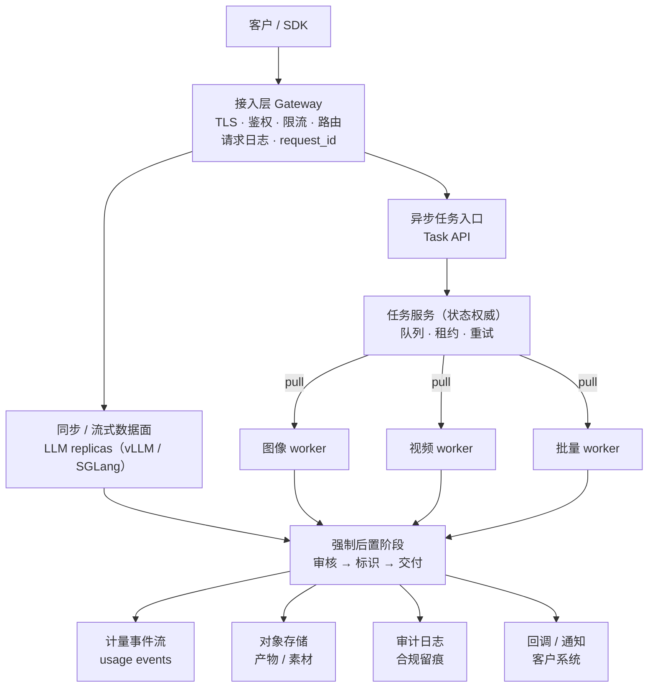
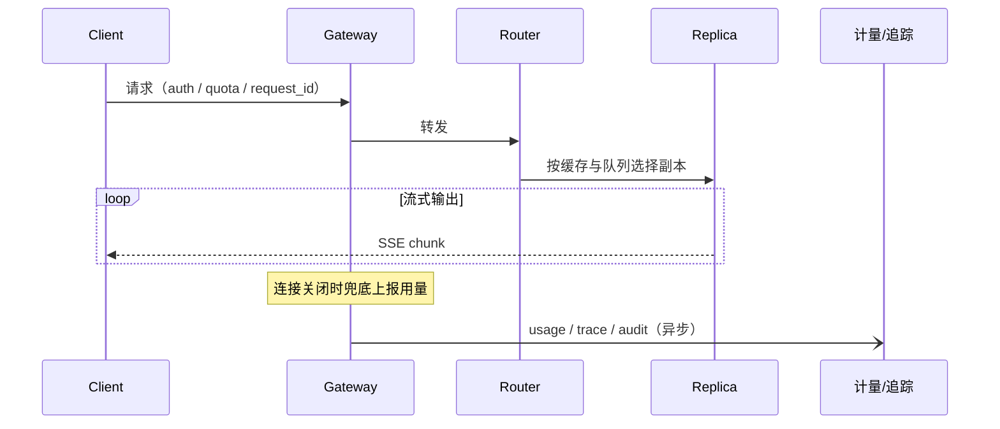
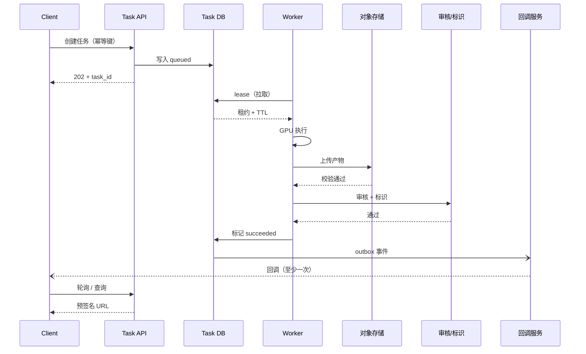
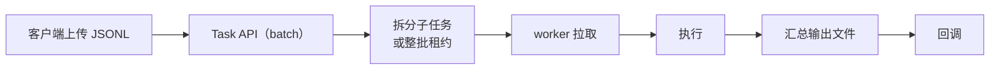
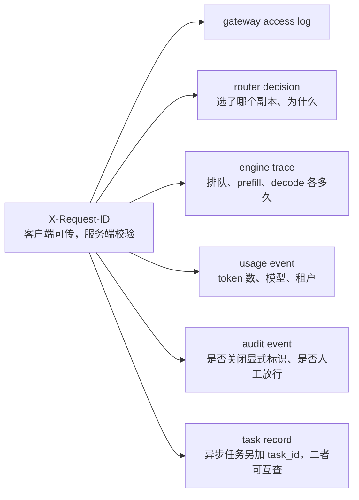

# 第 5 章 总体架构：一个控制面，多个数据面

> 控制面管"谁可以用什么、怎么算钱、出了事怎么查"；数据面管"把这一次生成跑完"。
> 两者混在一起，任何一个模态上线都要改一遍计费。

## 5.1 分层图

控制面（横向能力，所有模态共用）：

| 组件 | 职责 | 不负责 |
|---|---|---|
| 租户与 IAM | 组织、项目、Key、RBAC | 业务权限（如"谁能生成视频"由配额决定） |
| 模型目录 | 模型、版本、别名、部署规格、备案号 | 权重存储（只在目录里存引用） |
| 部署控制器 | 规格 → 副本（LWS/Deployment）、灰度、回滚 | 具体调度（交给 K8s） |
| 配额与调度策略 | 配额、优先级、抢占规则 | 单次请求路由 |
| 任务服务 | 状态机、队列、租约、重试 | GPU 执行 |
| 计量与计费 | 用量事件、预扣、结算、退款、账单 | 定价策略（产品决策） |
| 审核与标识 | 策略、调用、留痕、抽检 | 模型推理 |
| 审计 | 管理操作、敏感开关、数据访问 | 业务日志 |

## 5.2 三条调用路径

### 路径 A：同步 / 流式（LLM）

关键点：**计量在流结束后落账，但不能因为流中断而丢账**。做法是网关侧按 chunk 计数
并在连接关闭时兜底上报（第 32 章）。

### 路径 B：异步任务（图像短异步 / 视频）

关键点：**状态权威在中心库，worker 只上报进度**。worker 被 kill，租约超时，任务重新入队。

### 路径 C：批量（离线）

批量路径与路径 B 共用任务系统，但不共用队列（低优先级、可中断）。

## 5.3 状态面

| 存储 | 内容 | 一致性要求 |
|---|---|---|
| PostgreSQL | 租户、目录、任务、配额、账单 | 强一致（任务状态、扣费） |
| 对象存储 | 输入素材、生成产物、批量结果 | 强一致读，生命周期管理 |
| 事件流（Kafka/同类） | 用量事件、审计事件 | 至少一次 + 幂等消费 |
| 指标/追踪 | Prometheus + OTel | 最终一致，可采样 |
| 缓存（Redis/同类） | 会话、限流计数、路由表 | 可丢失，需可重建 |

〔建议〕**任务状态与计费状态必须同库或同事务边界**。跨库最终一致会导致"任务成功但没扣钱"
或"扣了钱但任务丢了"，两者都很难对账。

## 5.4 十个架构决策（ADR 候选）

| ID | 决策 | 理由 | 复核时点 |
|---|---|---|---|
| ADR-001 | 控制面自持，数据面可混合云 | 资产与责任不能外包 | 首次达到容量瓶颈 |
| ADR-002 | 按模态分资源池 | 时间尺度与 SLO 不同 | 混部收益被证实 |
| ADR-003 | 任务状态中心化，worker pull | 实例会死，push 会丢任务 | 队列吞吐不足时 |
| ADR-004 | 副本为调度原子，跨机用 LWS | TP/EP 需要拓扑保证 | 单机卡数变化 |
| ADR-005 | 模型别名 + 部署规格为一等公民 | 客户不随引擎/量化变化 | 每次上架 |
| ADR-006 | 网关只做横切，不做业务 | 避免每个模态改网关 | 新协议接入时 |
| ADR-007 | 计量事件至少一次 + 幂等去重 | 不能丢账，也不能重账 | 对账差异 > 0.1% |
| ADR-008 | 审核与标识是强制后置阶段 | 合规不可绕过 | 监管口径变化 |
| ADR-009 | 多集群按地域/合规拆，不按团队拆 | 减少跨集群依赖 | 出海 |
| ADR-010 | 自研架构适配优先上游 PR，其次插件，最后 fork | fork 的同步成本最高 | 每次引擎升级 |

## 5.5 失败域与降级

| 失败 | 影响 | 降级策略 |
|---|---|---|
| 单个推理副本挂 | 该副本在途请求失败 | 路由摘除 + 客户端重试（幂等） |
| 整个模型版本不可用 | 该模型全挂 | 切别名到上一版本；返回明确错误码 |
| 任务服务不可用 | 新任务无法提交 | 入口限流；已有任务继续执行（worker 本地有租约） |
| 计量流中断 | 账单延迟 | 网关本地缓冲 + 补报；先服务后计费 |
| 审核服务不可用 | 无法交付 | **拒绝服务**，不降级放行（合规红线） |
| 对象存储不可用 | 无法交付产物 | 任务保持 running，退避重试；不标记成功 |
| 网关过载 | 全站 | 快速拒绝 + Retry-After，不无限排队 |

一条铁律：**审核与标识不能降级放行**。宁可短时不可用，也不能交付未审核/未标识的内容。

## 5.6 request_id 贯穿

一个请求从进入到出账，必须能用一个 ID 串起来：

没有这条链，故障归因和账单争议都只能靠猜。

## 本章结论

- 一个控制面、多个数据面，是同时支持三种模态且不改计费的唯一可行结构。
- 任务状态与计费状态必须强一致；其他都可以最终一致。
- 审核与标识是强制阶段，不是可选插件。
- 十个 ADR 应尽早拍板，后面所有章节都建立在它们之上。

## 决策点（结合自身情况）

1. 任务库与计费库是否同库？若分库，补偿机制谁写？
2. 网关选型（自研 / Envoy 系 / 云网关），决定第 16、31 章的实现细节。
3. 是否接受"审核服务故障时拒绝服务"这条红线？
