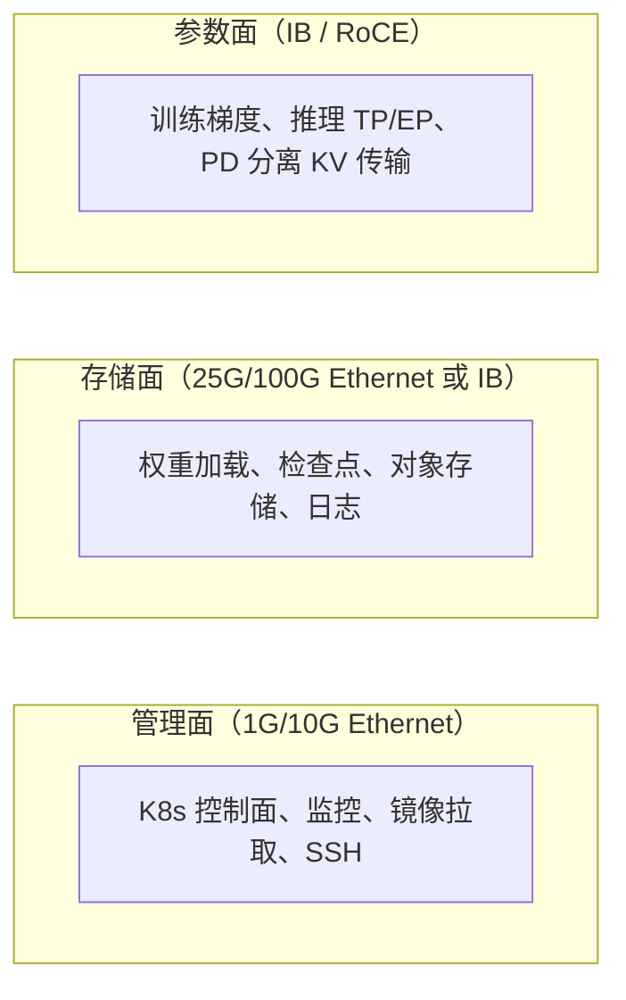

# 第 6 章 集群、网络与存储

> 千卡集群的性能，一半取决于卡，另一半取决于"卡与卡之间"。

## 6.1 机型与拓扑

推理与训练对机型的要求不同：

| 维度 | 训练 | 在线推理 |
|---|---|---|
| 显存 | 越大越好（激活 + 优化器状态） | 大（权重 + KV Cache） |
| 卡间互联 | NVLink/NVSwitch 必须 | TP 副本内必须；单卡副本可不要求 |
| 跨机网络 | IB/RoCE 高带宽、低延迟 | 同机优先；PD 分离时需要 RDMA |
| CPU/内存 | 数据加载吃 CPU | 视频解码吃 CPU |
| 本地盘 | 检查点写入 | 权重缓存、临时帧 |

〔建议〕起步阶段用**同构 8 卡机型**，不追求混插。异构集群会让调度、镜像、性能基线
全部翻倍，在团队规模有限时是负资产。

拓扑上要保证：

1. **一个 TP=8 的副本落在同一台机器**，走 NVLink，不跨 PCIe Switch。
2. **跨机副本（TP/EP > 8）落在同一 leaf 下**，避免跨 spine。
3. **视频任务的多卡并行**优先同机，否则帧间同步会被网络拖死。

## 6.2 三张网

最常见的三个错误：

1. **用管理网拉 100GB 权重**。结果：扩容时管理网打满，K8s 心跳超时，节点被误判 NotReady。
2. **参数面与存储面合一**。训练写检查点时把推理的 KV 传输挤掉，P99 抖动。
3. **只测带宽不测误码**。IB 链路有误码时带宽看起来正常，但 NCCL 会周期性卡顿。

## 6.3 IB 还是 RoCE

| 维度 | IB | RoCEv2 |
|---|---|---|
| 性能 | 稳定，原生无损 | 可达到接近水平 |
| 运维 | 专用交换、子网管理器 | 依赖 PFC/ECN 配置，调参复杂 |
| 成本 | 高 | 较低 |
| 故障排查 | 工具成熟 | 拥塞与丢包难定位 |
| 适用 | 大规模训练、PD 分离 | 中小规模、成本敏感 |

〔建议〕**训练与 PD 分离用 IB；纯推理的南北向用普通以太网。** 如果只有 RoCE，
必须先把 PFC/ECN 调通并做长稳测试，再上生产。

## 6.4 存储分层

| 层 | 介质 | 存什么 | 关键指标 |
|---|---|---|---|
| L0 寄存器/显存 | HBM | 权重、KV | 带宽 |
| L1 本地 NVMe | 单机盘 | 权重缓存、检查点暂存 | 读带宽 ≥ 10GB/s |
| L2 并行文件系统 | 全闪 | 训练数据、检查点 | 聚合带宽、元数据性能 |
| L3 对象存储 | 大容量 | 模型仓库、生成产物、日志 | 吞吐、成本、生命周期 |
| L4 归档 | 冷存储 | 审计、历史产物 | 取回时间 |

推理侧最重要的是 **L1 权重缓存**：冷启动时间的大头在这里（第 09 章）。
训练侧最重要的是 **L2 检查点写入带宽**：写一次 1TB 检查点如果只有 2GB/s，就是 8 分钟，
足以让"每 30 分钟一次"的检查点变成持续开销。

## 6.5 集群规格书（模板）

| 项 | 规格 | 数量 | 用途 |
|---|---|---|---|
| GPU 节点 A | 8×H100 80GB，NVSwitch，IB 400G×8 | ? | 训练 + 大模型推理 |
| GPU 节点 B | 8×L40S 48GB，PCIe，25G | ? | 图像/视频推理 |
| CPU 节点 | 64C/512G | ? | 视频解码、审核、网关 |
| 管理节点 | 16C/64G | 3 | K8s 控制面 |
| 存储 | 全闪并行 FS + 对象存储 | ? | 见 6.4 |
| 网络 | IB 交换 + 以太网 | ? | 见 6.2 |

## 6.6 多集群

什么时候必须拆集群：

| 触发 | 拆法 |
|---|---|
| 数据出境/地域合规 | 按地域拆，控制面统一 |
| 单集群超过调度上限（数千节点） | 按池拆，共享存储与目录 |
| 训练与推理互相干扰严重 | 按负载拆，网络互联 |
| 客户要求独占 | 按客户拆（专属集群） |

不要按**团队**拆集群。团队边界会变，集群边界不会；按团队拆的结果是每个集群都很小、
利用率都低、都要独立运维。

## 本章结论

- 同构 8 卡机型 + 三张网分离，是千卡级最省心的起点。
- 参数面决定训练与 PD 分离的上限；存储面决定冷启动与检查点开销。
- 多集群按地域/合规/负载拆，不按团队拆。
- 规格书要先写出来，再谈采购；否则会被供应商的现货牵着走。

## 决策点（结合自身情况）

1. 首批集群是否全 IB？若预算不足，RoCE 的长稳测试由谁负责？
2. 是否采购 L40S 类机型专用于图像/视频，还是全部用 H100 混跑？
3. 对象存储自建还是云上？出网成本如何计入定价？
