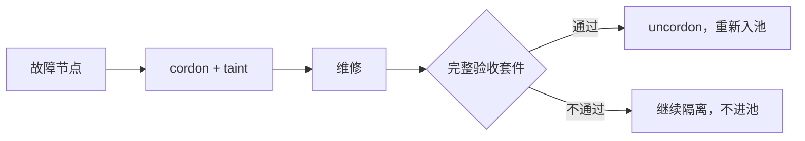

# 第 7 章 节点验收与基准测试

> 集群规模一大，故障就是常态。验收的意义不是"证明它好"，而是"建立基线，
> 让未来的退化可被看见"。

## 7.1 为什么必须做 burn-in

新节点上架后直接跑业务，会把三类问题带进生产：

1. **硬件缺陷**：显存坏块、NVLink 降速、IB 误码。表现为训练随机 hang、推理偶发 NaN。
2. **配置漂移**：驱动版本、CUDA、固件、MTU、PFC 不一致。表现为"同样的镜像，这台就是慢"。
3. **性能不达标**：标称 400G 的 IB，实际只跑 200G，但没人发现。

这三类问题的共同点是：**不会立刻报错，只会悄悄变慢**。所以必须用基准测试把它们变成数字。

## 7.2 验收项与通过标准

| # | 项目 | 方法 | 通过标准（示例） |
|---|---|---|---|
| 1 | GPU 识别 | `nvidia-smi -L`、DCGM | 数量、型号、显存、驱动一致 |
| 2 | 显存完整性 | 大矩阵填充 + 校验 | 无 ECC 错误，无 XID |
| 3 | 单卡算力 | FP16/BF16/FP8 GEMM | ≥ 标称的 90% |
| 4 | 单机卡间 | NVLink 带宽、P2P | ≥ 标称的 90% |
| 5 | 跨机带宽 | `ib_write_bw` 多对多 | ≥ 标称的 85% |
| 6 | IB 误码 | 端口计数器 | 压测 30 分钟无新增错误 |
| 7 | NCCL | all-reduce / all-to-all 扫描 | 与基线偏差 < 5% |
| 8 | 本地盘 | fio 顺序/随机 | 读 ≥ 10GB/s，写 ≥ 5GB/s |
| 9 | 存储面 | 并行 FS 聚合带宽 | ≥ 设计值的 80% |
| 10 | 镜像拉取 | 冷拉 20GB 镜像 | < 3 分钟 |
| 11 | 权重加载 | 冷加载 70B 权重 | 记录基线，用于冷启动预算 |
| 12 | 长稳 | 2 小时满载 | 无降频、无 XID、无掉卡 |

阈值不是拍脑袋：**所有"标称"都要来自采购合同或厂商规格书**，并把实测值写进基线库。
后续每次维修、升级都和基线比，而不是和记忆比。

## 7.3 NCCL 巡检

NCCL 的问题最难查，因为它是"集合通信"：一台慢，全体等。建议两级巡检：

- **快速巡检（每日）**：小规模 all-reduce（如 1GB），记录总线带宽；偏离基线 10% 告警。
- **全量巡检（每周/维修后）**：覆盖所有节点对的 ring/tree，生成带宽矩阵，找出离群节点。

一个实用判据：**同一拓扑下，节点间带宽的 p5/p50 比值**。如果 p5 明显偏低，
说明存在慢节点或链路问题，即使平均值正常。

## 7.4 维修后的回归

铁律：**维修后不做完整回归，就等于把同一故障重新引入集群。** 尤其是换卡、换线、
升级固件之后，必须重跑 7.2 的全部项目。

## 7.5 验收脚本清单

| 脚本 | 作用 | 输出 |
|---|---|---|
| `check_inventory` | 硬件清单与固件版本 | JSON，入 CMDB |
| `check_gpu_health` | XID、ECC、降频 | 通过/失败 + 明细 |
| `bench_gemm` | 单卡算力 | TFLOPS |
| `bench_nvlink` | 卡间带宽 | GB/s 矩阵 |
| `bench_ib` | 跨机带宽/延迟 | GB/s、us |
| `bench_nccl` | 集合通信 | 带宽矩阵 |
| `bench_storage` | 本地盘/并行 FS | IOPS、带宽 |
| `bench_pull` | 镜像/权重拉取 | 秒 |
| `soak_2h` | 长稳 | 温度、频率、错误计数 |

脚本本身要版本化，并与镜像绑定：**用哪个版本的脚本测的，要能追溯**，否则基线不可比。

## 7.6 常见坑

| 坑 | 现象 | 处理 |
|---|---|---|
| 只测单卡 | 训练仍慢 | 必须测卡间与跨机 |
| 在业务高峰期测 | 数据不可比 | 固定窗口、独占节点 |
| 忽略温度/降频 | 短测正常，长测掉性能 | 至少 2 小时满载 |
| 不记录固件版本 | 无法复现 | 入 CMDB，变更留痕 |
| 维修后直接上线 | 同故障复发 | 强制回归 |

## 本章结论

- 验收的目标是**建立基线**，不是发一张合格证。
- 必须覆盖单卡、卡间、跨机、存储、拉取、长稳六类，缺一类就会留一个盲区。
- 维修后不做回归，是故障复发的最主要原因。
- 基线数据要进 CMDB，与固件、驱动、脚本版本一起版本化。

## 决策点（结合自身情况）

1. 验收脚本自研还是用现成工具链？自研可控但要维护。
2. 长稳测试的时长标准（2 小时 / 8 小时 / 24 小时）？
3. 维修回归不通过时，节点的最终处置流程（返厂/降级使用）。
