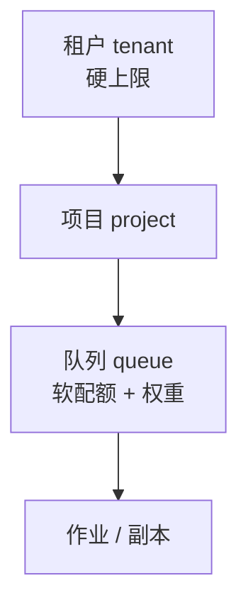

# 第 8 章 资源模型、配额与优先级

> Kubernetes 只告诉你"卡被占了"，不告诉你"这张卡该给谁、能给多久、能不能抢"。
> 后者是平台要补的语义。

## 8.1 GPU 的四种抽象

| 方式 | 粒度 | 隔离性 | 拓扑保证 | 适用 | 风险 |
|---|---|---|---|---|---|
| 整卡（device plugin） | 1 卡 | 强 | 无（需亲和性） | LLM 副本、视频、训练 | 小模型浪费整卡 |
| MIG | 1/2、1/4… | 较强（显存/算力分区） | 卡内 | 图像、小模型、开发 | 不是所有卡支持；与 TP 冲突 |
| 时间片 | 共享 | 弱（互相干扰） | 无 | 开发、CI | 延迟不可控，禁止生产 |
| DRA | 结构化设备 | 取决于驱动 | 强 | 新一代集群 | 生态成熟度待观察〔核验〕 |

〔建议〕

- **LLM 与视频：整卡**。TP/EP 需要确定的卡数与互联，MIG 会把拓扑切碎。
- **图像：整卡优先，小模型可 MIG**。前提是单张图能在 1/4 卡内跑完且延迟可接受。
- **时间片只用于开发与 CI**，生产禁用。理由：LLM 的 P99 对显存带宽极敏感，
  共享卡的抖动无法用调度弥补。
- **DRA 暂不作为主线**，但资源模型要预留"设备属性"字段（显存、互联类型、NUMA），
  便于未来迁移。

## 8.2 拓扑保证

K8s 默认调度器不知道"这 8 个 Pod 要在一台机器上、并且走 NVLink"。三种做法：

| 做法 | 说明 | 代价 |
|---|---|---|
| Pod 亲和性 + 节点标签 | 把 TP 组绑到同一节点 | 节点规格变化时要改标签体系 |
| LeaderWorkerSet（LWS） | 一个副本 = 一个 leader + N worker，原子调度 | 引入新控制器 |
| 拓扑感知调度器（volcano/koordinator 等） | 按 NUMA/交换机域装箱 | 运维复杂度上升 |

〔建议〕**推理副本用 LWS，训练作业用 Gang 调度器。** 两者都不要依赖手写亲和性，
因为亲和性是"尽力而为"，不是"全有或全无"。

一个必须验证的场景：**跨机副本**。TP=16 的副本分布在两台机器时，要确认：
同一 leaf、IB 端口同 rail、NCCL 走正确的 GID。任何一项不满足，性能都会掉 30% 以上。

## 8.3 配额的三层



| 层 | 作用 | 实现 |
|---|---|---|
| 租户 | 计费与合同主体 | 控制面数据库 |
| 项目 | 资源与权限隔离 | Namespace + ResourceQuota |
| 队列 | 公平性与优先级 | 自定义 CRD + 调度器 |

**配额 ≠ 容量**。配额是"最多能用多少"，容量是"实际有多少"。当所有租户的配额之和
超过物理容量时，必须有队列和公平策略，否则先到先得。

〔建议〕配额可以超卖（例如总配额 = 容量 × 1.5），但**在线池的配额不允许超卖**，
因为在线池要兑现 SLO。

## 8.4 优先级与抢占

| PriorityClass | 值（示例） | 负载 | 可被谁抢占 |
|---|---|---|---|
| `system-critical` | 100000 | 网关、任务服务、审核 | 不可 |
| `online-paid` | 10000 | 付费客户的在线副本 | 不可（同池内可驱逐低优） |
| `online-free` | 5000 | 免费额度流量 | `online-paid` |
| `image` | 3000 | 图像生成 | `online-*` |
| `video` | 2000 | 视频任务 | `online-*`、`image` |
| `batch` | 1000 | 离线批量、评测 | 所有 |
| `dev` | 0 | 开发机 | 所有 |

抢占的三条规则：

1. **只允许跨优先级抢占，不允许同优先级互抢**（避免抖动）。
2. **抢占必须感知工作负载**：训练要等检查点，视频要等任务边界（第 11、22 章）。
3. **抢占要留缓冲**：一次只抢够用的量，不要为了"整齐"把整个节点清空。

## 8.5 命名空间不是安全边界

Namespace + ResourceQuota 解决的是**配额与组织**，不是**安全隔离**。真正的隔离需要：

| 需求 | 手段 |
|---|---|
| 网络隔离 | NetworkPolicy + 默认拒绝 |
| 容器逃逸防护 | Pod Security Admission、非 root、只读根文件系统 |
| 多租户强隔离 | 独立节点池 / 独立集群 / 虚拟化 |
| 密钥隔离 | 每租户独立 Secret + KMS 加密 |

对外售卖的 MaaS，如果客户包含不受信任方（例如自助注册），**必须做节点池级隔离**，
不能只靠 Namespace。

## 8.6 资源模型的数据结构（建议）

```yaml
gpuProfile:
  name: h100-80g-nvswitch
  vendor: nvidia
  memoryGB: 80
  interconnects: [nvlink4, ib400]
  migCapable: true
  topologyLabels: [rack, leaf, rail]
```

部署规格引用 `gpuProfile`，而不是直接写 `nvidia.com/gpu: 8`。这样换机型时只改 profile，
不用改每个模型的 YAML。

## 本章结论

- 整卡 + LWS 是推理的主流；MIG 只在小模型和图像上谨慎使用；时间片禁止生产。
- 配额必须分三层，且在线池不超卖。
- 抢占要感知负载，不能只看优先级数字。
- Namespace 不是安全边界，自助注册场景必须做节点池隔离。

## 决策点（结合自身情况）

1. 是否引入 LWS 作为副本控制器？替代方案是 StatefulSet + 亲和性，但原子性弱。
2. 在线池配额是否允许超卖？蓝本建议不允许。
3. 自助注册客户是否单独节点池？这直接影响成本模型。
