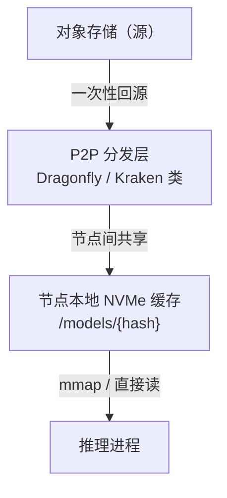

# 第 9 章 权重、镜像与制品分发

> 冷启动的 80% 时间花在"把东西搬到卡边上"，而不是"把模型跑起来"。

## 9.1 三类制品的体积

| 制品 | 典型体积 | 变更频率 | 分发难点 |
|---|---|---|---|
| 容器镜像（引擎 + 依赖） | 5~20GB | 每周 | 层复用、拉取并发 |
| 模型权重（70B FP8） | 70GB | 每月 | 带宽、缓存、校验 |
| 模型权重（视频扩散） | 10~50GB | 每月 | 多文件、加载慢 |
| 分词器/配置/适配器 | KB~GB | 随权重 | 版本一致性 |

一个 70B 模型冷启动，如果从对象存储拉 70GB、按 500MB/s 算，就是 140 秒；
如果 20 个副本同时扩容，就是 1.4TB 的出流量，源站直接被打满。这是**扩容慢**的根本原因，
不是引擎启动慢。

## 9.2 分发架构

四层缺一不可：

| 层 | 作用 | 关键指标 |
|---|---|---|
| 源 | 权威副本、版本归档 | 可用性、出网成本 |
| P2P | 把 N 个副本的拉取变成 1 次回源 + N-1 次内网 | 命中率、内网带宽 |
| 本地缓存 | 避免每次启动都拉 | 命中率、淘汰策略 |
| 进程加载 | mmap、分片并行加载 | 加载耗时 |

〔建议〕**权重不进镜像。** 镜像只带引擎与依赖，权重挂载本地缓存。理由：镜像层不可变，
权重需要独立灰度与回滚；把权重打进镜像会让镜像仓库变成模型仓库，且每次换模型都要重建镜像。

## 9.3 本地缓存的淘汰

| 策略 | 说明 | 适用 |
|---|---|---|
| LRU | 按最近使用 | 通用 |
| 按模型优先级 | 在线模型常驻，批处理模型可淘汰 | 多模型混部 |
| 预留配额 | 每个节点为"热模型"预留空间 | 保证扩容速度 |
| 按代际清理 | 只保留最近 N 个版本 | 防止磁盘被旧版本占满 |

必须有的保护：**磁盘水位告警**（>80% 告警，>90% 停止拉取新模型），否则会出现
"缓存把系统盘写满，kubelet 驱逐所有 Pod"的连锁故障。

## 9.4 镜像标准化

| 项 | 要求 |
|---|---|
| 基础镜像 | 按 CUDA 大版本分层，不按模型分 |
| 引擎版本 | 与驱动矩阵绑定，写入标签 |
| 体积 | 目标 < 10GB；超过要拆层 |
| 启动命令 | 统一 entrypoint，参数通过环境变量/配置文件 |
| 健康检查 | 提供 `/healthz`（进程活）与 `/readyz`（模型可服务） |
| 非 root | 强制 |
| 标签 | `engine-version-cuda-version-git-sha`，不可用 `latest` |

## 9.5 版本矩阵

驱动、CUDA、引擎、框架四者必须有一个明确的兼容矩阵：

| 驱动 | CUDA | 引擎 | 状态 | 备注 |
|---|---|---|---|---|
| 550.x | 12.4 | vLLM A | 生产 | 当前基线 |
| 550.x | 12.4 | SGLang B | 灰度 | 待压测 |
| 560.x | 12.6 | vLLM C | 评估 | 新卡需要 |

矩阵要随每次升级更新，并且**节点打标签**（`driver=550`），调度时按标签匹配，
避免"新驱动节点跑了旧镜像"这种隐性故障。

## 9.6 制品元数据

每个模型版本必须携带：

| 字段 | 用途 |
|---|---|
| `sha256` | 完整性校验，加载前必查 |
| `signature` | 来源可信（cosign 类） |
| `license` | 合规审查，禁止未授权商用 |
| `sbom` | 依赖漏洞扫描 |
| `tokenizer_hash` | 防止权重与分词器版本错配 |
| `chat_template_hash` | 防止对话格式漂移（第 28 章） |
| `created_at` / `source` | 追溯 |

**加载前校验哈希，失败则拒绝启动**，不要"先跑起来再说"。半损坏的权重会导致
输出质量下降而不报错，这是最难查的一类故障。

## 9.7 冷启动预算

以 70B FP8、8 卡副本为例（示意）：

| 阶段 | 耗时 | 优化手段 |
|---|---|---|
| 调度 + 拉镜像 | 60~180s | 镜像预热、P2P |
| 拉权重（冷） | 120~300s | 本地缓存、P2P |
| 权重加载到显存 | 30~60s | 分片并行、直接 I/O |
| 引擎初始化 | 20~60s | 减少 warmup 步数 |
| 图编译（如 torch.compile） | 60~300s | 缓存编译结果、关闭动态 shape |
| 预热请求 | 30~60s | 小批量预热 |
| **合计** | **5~15 分钟** | |

这个数字直接决定第 18 章的弹性策略：**扩容必须提前 10 分钟以上**，
或者保留最小副本吸收突发。

## 9.8 本章结论

- 冷启动的瓶颈是制品分发，不是引擎启动。
- 权重与镜像分离，权重走 P2P + 本地缓存，镜像只带引擎。
- 版本矩阵与节点标签必须绑定，否则会出现隐性不兼容。
- 哈希校验是硬门槛，不能跳过。

## 决策点（结合自身情况）

1. P2P 分发自建还是用现成方案？自建要评估运维成本。
2. 本地缓存盘容量与预留策略（每个节点预留几个热模型）？
3. 是否允许"跳过哈希校验"的调试开关？蓝本建议生产禁用。
