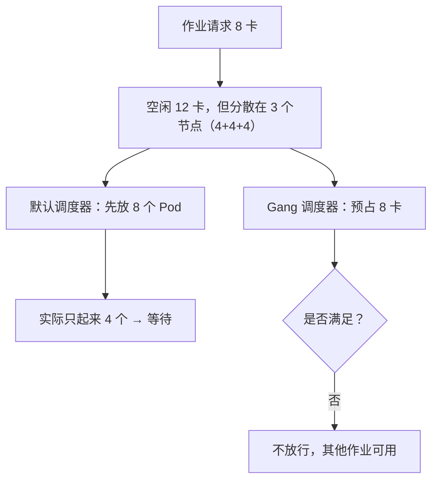
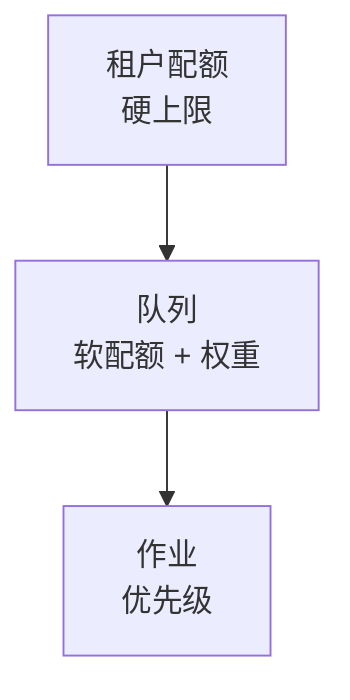
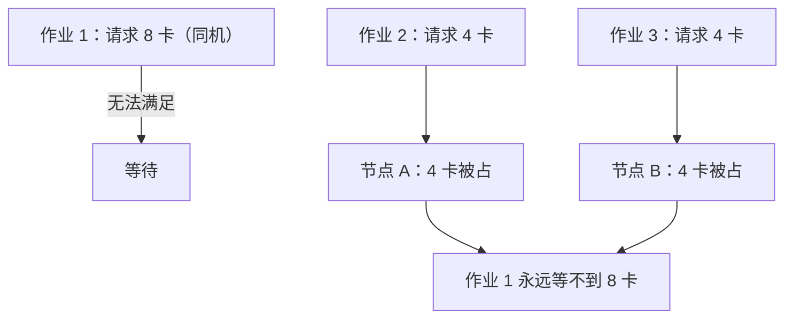

# 第 10 章 调度：Gang、队列与拓扑

> 默认调度器逐个 Pod 决策。它不知道"这 8 个 Pod 是一件事"，于是会给你一半的卡，
> 然后让两个任务互相等死。

## 10.1 三个默认调度器做不到的事

| 需求 | 默认调度器 | 后果 |
|---|---|---|
| 一个作业的 N 个 Pod 同时启动 | 逐个绑定 | 部分启动，占着卡等，集群死锁 |
| 队列级公平与配额 | 无队列概念 | 大客户先占先得 |
| 拓扑感知（同一 leaf/NVLink 域） | 只看资源余量 | TP 跨 spine，带宽掉一半 |
| 抢占时先保存进度 | 直接删除 Pod | 训练丢进度 |

这不是配置问题，是模型问题。默认调度器的原子是 Pod，而训练/推理的原子是**作业/副本**。

## 10.2 Gang 调度

Gang 的语义：**要么全部满足，要么一个都不占**。

实现方式：

| 方案 | 说明 | 适用 |
|---|---|---|
| Volcano | 批处理调度器，原生 gang/queue | 训练为主 |
| Kueue + 调度器 | 队列与配额管理，配合 gang | 多租户 |
| 自研 coscheduling | 侵入小，但功能有限 | 小规模 |

〔建议〕**训练用成熟 gang 调度器，不自研。** 自研 gang 的坑在"预占-回滚-死锁检测"，
没有足够规模验证很难写对。

## 10.3 队列与公平

三层结构：

关键概念：

| 概念 | 含义 | 作用 |
|---|---|---|
| `guarantee` | 队列保底资源 | 防止小队列饿死 |
| `deserved` | 按权重应得资源 | 公平性 |
| `capacity` | 队列上限 | 防止单队列吃满 |
| `borrow` | 空闲时可借 | 提升利用率 |

公平性算法用 DRF（Dominant Resource Fairness）或加权公平；不要用简单轮询，
因为不同作业的资源形状差异很大（1 卡 × 8 小时 vs 64 卡 × 10 分钟）。

## 10.4 拓扑感知

三类拓扑约束，强度递增：

| 约束 | 表达 | 不满足的代价 |
|---|---|---|
| 同机 | 8 卡在一台 | TP 走 PCIe，带宽降 5~10 倍 |
| 同 leaf | 跨机但同一交换机 | 跨 spine，延迟翻倍 |
| 同 rail | IB 端口同 rail | 拥塞，带宽不稳 |

实现方式：

1. **节点打标签**：`topology.kubernetes.io/zone`、自定义 `leaf`、`rail`。
2. **调度器拓扑插件**：按 `maxSkew` 装箱，而不是随意分散。
3. **副本控制器**（LWS）保证组内原子性。

一个反直觉的点：**装箱（bin-packing）与分散（spreading）的目标相反**。
训练要装箱（减少跨机），在线推理要分散（避免单节点故障影响全部副本）。
两者不能用同一套策略。

## 10.5 调度策略表

| 负载 | 调度器 | 原子 | 装箱策略 | 抢占 |
|---|---|---|---|---|
| 训练 | Gang（Volcano/Kueue） | 整个作业 | 强装箱（同 leaf） | 安全点抢占 |
| LLM 在线 | 默认 + LWS | 副本 | 分散（跨节点/机架） | 不被抢 |
| 图像 | 默认 + 队列 | 单 Pod | 装箱 | 可被在线抢 |
| 视频 | 队列 + gang（多卡） | 任务组 | 强装箱（同机优先） | 任务边界 |
| 批量 | 队列 | 作业 | 尽力 | 随时 |

## 10.6 一个典型死锁

Gang + 装箱的正确行为：作业 1 到达时预占 A+B 的 8 卡（若允许跨机），
或者直接排队等一台整机；作业 2/3 若优先级低，应被挡在队列里，而不是切碎资源。

## 本章结论

- 默认调度器的原子是 Pod，训练/推理的原子是作业/副本，必须换调度器。
- Gang 解决"部分启动"，队列解决"公平"，拓扑解决"性能"，三者缺一不可。
- 训练要装箱，在线要分散，不能共用一套策略。
- 不要自研 gang 调度器。

## 决策点（结合自身情况）

1. 选 Volcano 还是 Kueue？前者功能全，后者与 K8s 生态更近。
2. 训练作业是否允许跨机（TP/PP > 8）？若允许，拓扑约束要更严。
3. 队列的 `guarantee` 按团队还是按客户设？
