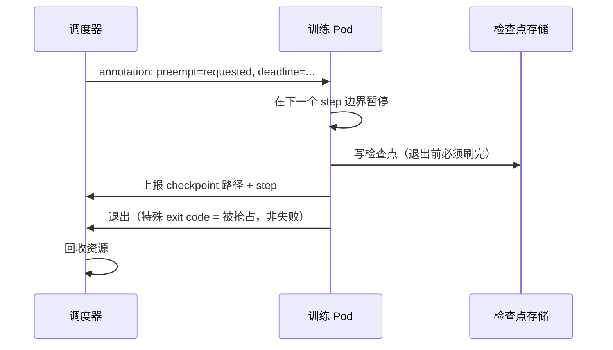

# 第 11 章 弹性、抢占与 checkpoint

> 抢占本身不贵，丢进度才贵。检查点的成本必须小于"重算"的期望成本。

## 11.1 弹性的两个前提

训练要能弹性，必须先满足：

1. **可恢复**：能从检查点恢复到一致状态（模型、优化器、数据加载器、随机数）。
2. **可缩容**：改变 world size 后，并行策略能重新切分（resharding）。

第二点常被忽略。很多训练框架只能"重启到原规模"，不能"缩到 4 卡继续"。
如果只能重启，那弹性只是"更快地重新排队"，不是真正的弹性。

## 11.2 检查点策略

| 维度 | 选项 | 建议 |
|---|---|---|
| 频率 | 固定间隔 / 按步数 / 自适应 | 按步数 + 自适应 |
| 方式 | 同步 / 异步 | 异步（写盘不阻塞训练） |
| 分片 | 单文件 / 每 rank 一片 | 每 rank 一片，元数据汇总 |
| 保留 | 全部 / 最近 N 代 | 最近 2~3 代 + 里程碑 |
| 存储 | 本地 / 并行 FS / 对象存储 | 本地快写 + 异步上传 |

**检查点间隔的估算**（简化模型）：

```
期望浪费 = 检查点开销 × (总时长 / 间隔) + 间隔 / 2 × 故障率
最优间隔 ≈ sqrt(2 × 检查点开销 × MTBF)
```

举例：写一次检查点 60 秒，MTBF 20 小时，则最优间隔约
`sqrt(2 × 60 × 72000) ≈ 2940 秒 ≈ 49 分钟`。这与"每 30 分钟一次"的经验值同量级。
实际要按写入带宽和故障率重算，不要照搬。

## 11.3 抢占协议

抢占有两种实现，代价差别很大：

| 方式 | 行为 | 丢进度 | 适用 |
|---|---|---|---|
| 直接删除 Pod | SIGTERM → 宽限期 → SIGKILL | 宽限期内没存完就全丢 | 低优先级批处理 |
| 安全点抢占 | 通知 → 训练到下一个检查点 → 保存 → 退出 | 最多一个检查点间隔 | 训练、视频 |

〔建议〕**训练与视频必须走安全点抢占。** 具体协议：



`deadline` 必须大于"最坏检查点写入时间"，否则等于直接杀。

## 11.4 恢复时间目标

```
RTO ≈ 调度等待 + 镜像/权重加载 + 检查点读取 + 通信组初始化 + 回到故障点
```

千卡训练的 RTO 往往是 **10~30 分钟**，其中检查点读取和通信组初始化占大头。
如果故障每几天一次，这个开销可以接受；如果每天多次，就要优化。

优化顺序：

1. 检查点读取并行化（多 rank 并发读）。
2. 本地缓存最近一代检查点。
3. 跳过不必要的初始化（复用编译缓存）。
4. 减少重启时的全局 barrier。

## 11.5 与调度的接口

调度器需要知道三件事，否则无法做安全点抢占：

| 信息 | 来源 | 用途 |
|---|---|---|
| 当前 step | 训练进程上报 | 判断是否在安全点 |
| 最近检查点时间 | 训练进程上报 | 估算丢失进度 |
| 检查点写入耗时 | 历史统计 | 设置 deadline |

这些信息通过 sidecar 或 metrics 端点暴露，不要靠日志解析。

## 11.6 常见错误

| 错误 | 后果 | 修正 |
|---|---|---|
| 只存模型，不存优化器和数据加载器状态 | 恢复后 loss 跳变 | 存完整状态 |
| 检查点写到共享 FS 但不同步 | 读到半截文件 | 原子写（临时文件 + rename） |
| 抢占用 SIGKILL | 丢全部进度 | 用安全点协议 |
| 检查点间隔固定 30 分钟不看成本 | 小任务开销过大 | 按任务规模自适应 |
| 恢复后不校验 | 静默错误 | 校验 step、loss、哈希 |

## 本章结论

- 弹性的前提是可恢复 + 可缩容，缺一不可。
- 检查点间隔应按"写入成本 × 故障率"估算，不是拍脑袋。
- 抢占必须走安全点协议，宽限期要覆盖最坏写入时间。
- RTO 的大头在检查点读取和通信初始化，不在调度。

## 决策点（结合自身情况）

1. 训练框架是否支持 resharding？若不支持，第 10 章的弹性策略要降级。
2. 检查点保留几代？存储成本与恢复点之间要取舍。
3. 被抢占的任务是否自动重新排队？重排队是否消耗配额？
