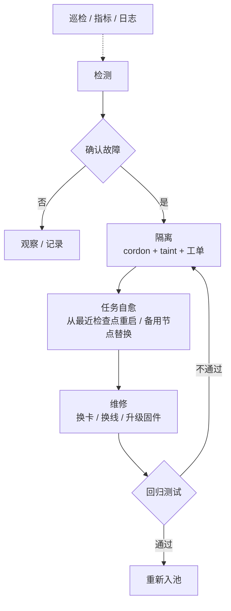

# 第 12 章 故障闭环与慢节点

> 规模一大，故障不是异常，是常态。平台的价值不在于"不出故障"，
> 而在于"每次故障只损失一个检查点"。

## 12.1 故障分类

| 类型 | 例子 | 表现 | 处理 |
|---|---|---|---|
| 硬故障 | 掉卡（XID 79）、显存不可用、电源 | 任务立即报错 | 隔离 + 换节点 |
| 软故障 | 单比特 ECC、XID 13/31/43、链路重传 | 可能不报错，性能下降 | 记录 + 观察 + 阈值隔离 |
| 性能故障 | NVLink 降速、IB 误码、CPU 争抢 | 训练变慢，指标无异常 | 巡检 + 基线对比 |
| 配置漂移 | 驱动/固件/CUDA 不一致 | "同样镜像这台就是慢" | 节点标签 + 准入 |
| 静默错误 | 权重损坏、NaN、loss 异常 | 结果错但不报错 | 校验 + 回滚 |

最危险的是后两类：**不报错，但结果错或变慢**。

## 12.2 检测信号

| 信号 | 采集 | 判据（示例） |
|---|---|---|
| XID | DCGM / dmesg | 79 立即隔离；13/31/43 计数超阈值隔离 |
| ECC | DCGM | 单比特增长速率；双比特立即隔离 |
| 温度/降频 | DCGM | 持续 > 阈值触发降频告警 |
| NVLink | DCGM / nvbandwidth | 带宽 < 基线 90% |
| IB 误码 | 端口计数器 | 压测期间增长 > 0 |
| NCCL | 定期巡检 | 带宽矩阵离群 |
| 训练 step 时间 | 框架上报 | 同作业内 p99/p50 > 1.2 |
| loss 曲线 | 训练日志 | 突增/NaN，排除数据问题后隔离 |

采集频率要分两级：**秒级指标**（温度、利用率）与**分钟级巡检**（NCCL、带宽）。
不要用秒级采集去跑 NCCL，成本太高。

## 12.3 闭环



每一环都要有**自动化**，否则规模上来后人力跟不上：

| 环节 | 自动化程度 | 说明 |
|---|---|---|
| 检测 | 全自动 | 告警 + 事件 |
| 隔离 | 全自动（硬故障）/ 人工确认（软故障） | 避免误杀 |
| 自愈 | 全自动 | 任务级重试策略 |
| 维修 | 人工 | 现场操作 |
| 回归 | 全自动 | 验收套件 |
| 入池 | 自动（回归通过后） | 去掉 taint |

## 12.4 备用节点

```
集群容量 = 业务容量 + 热备容量
热备比例 ≈ 2%~5%（按故障率和替换时长定）
```

热备不是浪费：如果替换一个节点需要 30 分钟，而故障每 2 天一次，热备就是
"把 30 分钟的停机变成 0"。热备比例要用故障率算，不要凭感觉。

备用节点也要跑巡检，否则"备用的也是坏的"。

## 12.5 慢节点（straggler）

慢节点不会让任务挂掉，只会悄悄拖慢全体。三种识别方法：

| 方法 | 原理 | 灵敏度 |
|---|---|---|
| step 时间分布 | 同作业各 rank 的 step 时间 | 高，但受数据影响 |
| NCCL 带宽矩阵 | 节点对带宽离群 | 高，定位到链路 |
| 微基准回放 | 定期跑固定 GEMM/all-reduce | 中，可跨作业比较 |

判据示例：某 rank 的 step 时间持续高于中位数 20%，且排除数据加载与 checkpoint 影响，
即可疑。处理：

1. 先降级（从池中摘除，不接新任务）。
2. 复现（跑微基准）。
3. 修复（换线/换卡/调 BIOS/关超线程）。
4. 回归。

**不要用 loss 判断慢节点**：慢节点的 loss 通常正常，只是慢。

## 12.6 指标目标

| 指标 | 目标（示例） | 说明 |
|---|---|---|
| 故障检测时间 | < 5 分钟 | 从发生到告警 |
| 隔离时间 | < 10 分钟 | 含人工确认 |
| 任务恢复时间 | < 30 分钟 | 含调度、加载、恢复 |
| 维修回归通过率 | 100% | 不通过不入池 |
| 月度非计划中断 | 按规模设定 | 千卡级以"次/周"计 |

## 12.7 值班手册目录

| 章节 | 内容 |
|---|---|
| 告警分级 | P0/P1/P2 的判定与响应时限 |
| 常见故障 | XID 对照表、NCCL 卡顿、IB 误码 |
| 隔离操作 | cordon/taint/drain 的命令与检查项 |
| 任务恢复 | 如何找到检查点、如何重提 |
| 升级路径 | 何时叫硬件厂商、何时叫平台 |
| 复盘模板 | 时间线、根因、改进项、责任人 |

## 本章结论

- 故障分五类，最危险的是"不报错但变慢/算错"。
- 闭环的六环都要自动化，否则规模上来后人力不可持续。
- 热备比例要按故障率与替换时长计算。
- 慢节点要靠 step 时间与带宽矩阵识别，不能靠 loss。

## 决策点（结合自身情况）

1. 热备比例定多少？取决于采购周期与故障率。
2. 软故障（单比特 ECC）的隔离阈值由谁定？
3. 是否引入第三方硬件健康预测？成本与收益要评估。
