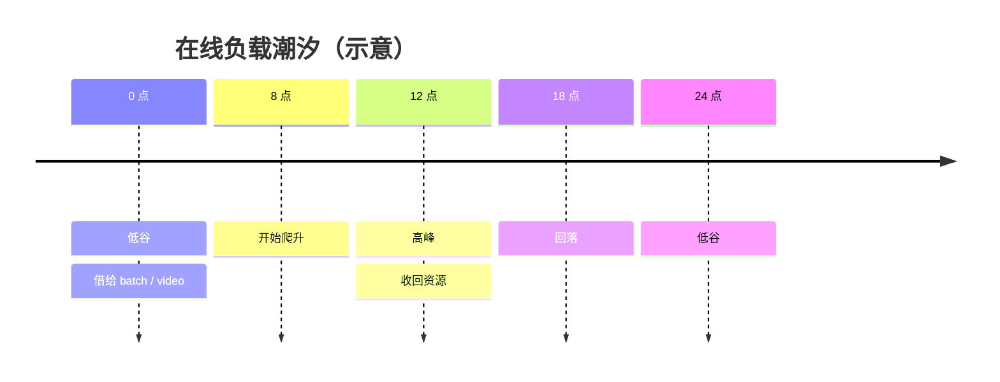
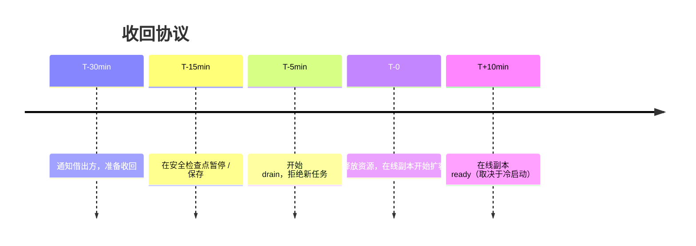

# 第 13 章 训练可观测与潮汐混部

> GPU-Util 是最会骗人的指标：只要有一个 kernel 在跑，它就显示 100%，
> 哪怕这个 kernel 在等通信、等数据、等锁。

## 13.1 四层指标

| 层 | 指标 | 回答的问题 |
|---|---|---|
| 硬件 | 温度、功耗、时钟、XID、ECC、NVLink 带宽 | 卡健康吗 |
| 作业 | step 时间、吞吐、loss、梯度范数 | 训练正常吗 |
| 效率 | MFU、SM Active、通信占比、数据等待 | 卡被有效利用了吗 |
| 业务 | 队列等待、配额使用、卡时成本、交付 | 资源花得值吗 |

只有四层都有，才能回答"这张卡到底有没有被有效利用"。

## 13.2 三个关键效率指标

**MFU（Model FLOPs Utilization）**

```
MFU = 实测模型 FLOPs/s ÷ 硬件峰值 FLOPs/s
```

它是"训练效率"的黄金指标，但要注意：不同模型的 FLOPs 计算方式不同，
跨模型比较时要统一口径。经验上 40%~55% 已经不错，低于 30% 要查原因。

**SM Active**

DCGM 的 `SM Active` 表示 SM 处于活跃状态的时间比例，比 `GPU-Util` 更能反映
"是否真的在算"。但也要结合 occupancy：SM active 高但 occupancy 低，说明在等内存。

**通信占比**

```
通信占比 = NCCL 时间 ÷ step 总时间
```

超过 20%~30% 时，要检查并行策略与拓扑；超过 50% 基本是配置问题。

## 13.3 归因

所有训练指标都要带三个标签：`tenant`、`job`、`user`。否则无法回答：

- 哪个团队用了最多卡时？
- 哪个作业的效率最低？
- 这部分成本该记到谁头上？

归因数据要与配额系统打通：**配额使用量、实际用量、计费卡时**三者要能对上。
对不上时，以计量系统的数据为准，配额系统只做准入。

## 13.4 潮汐混部



混部的三种形态：

| 形态 | 做法 | 风险 |
|---|---|---|
| 时间片 | 夜间跑批，白天跑在线 | 切换时的排队与冷启动 |
| 借还 | 在线空闲卡借给低优先级 | 收回时的抢占 |
| 同卡共享 | MIG / 时间片共享 | 干扰，通常不推荐生产 |

〔建议〕**只做"借还"，不做"同卡共享"。** 理由：LLM 的延迟对显存带宽极敏感，
共享带来的干扰无法用调度补偿；而借还的边界清晰，失败可回滚。

## 13.5 三条红线

借出资源前必须检查，任一不满足就不借：

| 红线 | 检查 | 不满足的后果 |
|---|---|---|
| SLO | 在线池的 P99 与队列深度是否在安全区 | 借出后无法吸收突发 |
| 显存 | 借出负载是否会触发同节点显存压力 | OOM 连锁 |
| 网络 | 借出负载是否吃满参数面 | 在线推理 TP 通信抖动 |

## 13.6 收回协议



关键数字：**T 到 T+10min 必须小于在线侧的扩容提前量**。如果在线扩容需要 15 分钟，
那收回就要提前 15 分钟开始，否则会在高峰初期出现容量缺口。

收回的优先级：先收 batch，再收 video，最后才收 image。理由：重算成本依次上升。

## 13.7 混部的收益核算

混部不是免费的，要算三笔账：

| 账 | 计算 | 判断 |
|---|---|---|
| 收益 | 借出卡时 × 单位卡时成本 | 正 |
| 风险 | SLO 违约概率 × 赔付/流失成本 | 必须小于收益 |
| 复杂度 | 运维人力 + 故障排查时间 | 隐性成本 |

如果借出的是"本来就会空转的卡"，收益是纯增量；如果借出导致在线扩容，
收益可能为负。**只借确定会空转的容量。**

## 本章结论

- GPU-Util 不能作为效率指标，要看 MFU、SM Active、通信占比。
- 归因必须到租户/作业/人，否则成本无法回收。
- 混部只做借还，不做同卡共享。
- 收回协议的关键是提前量，必须大于在线扩容时间。

## 决策点（结合自身情况）

1. MFU 的计算口径由谁维护？不同模型要用同一套公式。
2. 借还的粒度是整节点还是整卡？整节点更容易回收。
3. 混部收益是否计入团队考核？若不计入，没人愿意借出。
