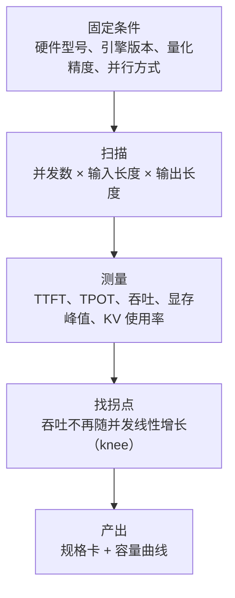
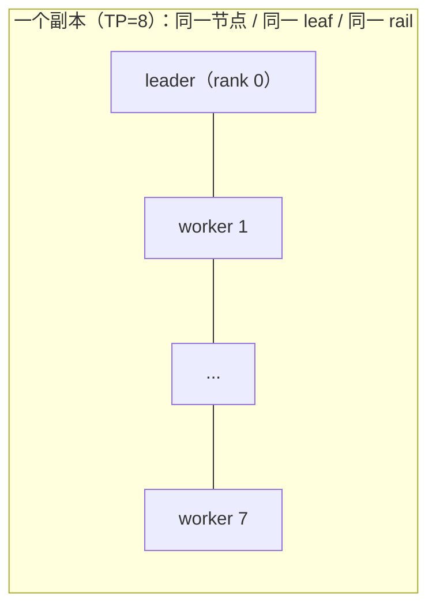

# 第 14 章 部署规格：从 profiling 到规格卡

> 训练用 1024 卡，不代表推理要 1024 卡。同一个模型，推理可能 8 卡一个副本。
> 把训练资源当推理规格，是 MaaS 最常见、也最贵的错误。

## 14.1 显存构成完全不同

| 组成 | 训练 | 推理 |
|---|---|---|
| 权重 | 有 | 有（可量化到 FP8/INT4） |
| 梯度 | 有 | 无 |
| 优化器状态 | 有（Adam 混合精度约 16 字节/参数） | 无 |
| 激活 | 有（与 batch、序列长度相关） | 少量 |
| KV Cache | 无 | 有（随并发 × 上下文增长） |
| 通信缓冲 | 有 | 有（TP/EP） |

一个 70B 模型：

```
训练（Adam, FP16 混合）：权重 140GB + 梯度 140GB + 优化器 280GB + 激活 ≈ 600GB+
推理（FP8）：权重 70GB + KV Cache（可变）+ 缓冲 ≈ 80~200GB
```

所以推理的并行策略、卡数、拓扑，都要**重新 profiling**，不能从训练配置推导。

## 14.2 Profiling 流程



必须固定的条件（否则数据不可比）：

| 条件 | 为什么 |
|---|---|
| 引擎版本 | 不同版本的调度策略差异很大 |
| 量化精度 | FP8/INT4 的吞吐与质量都不同 |
| 并行方式 | TP=8 与 TP=4×2 的通信开销不同 |
| 输入/输出长度分布 | 长 prompt 与长输出是两种负载 |
| 是否开启前缀缓存 | 命中率高时吞吐可翻倍 |

## 14.3 规格卡字段

| 字段 | 示例 | 用途 |
|---|---|---|
| `model_alias` | `llm-pro` | 客户看到的稳定名 |
| `model_version` | `2026-10-01` | 内部版本 |
| `gpu_profile` | `h100-80g-nvswitch` | 机型 |
| `precision` | `fp8` | 精度 |
| `parallelism` | `tp=8` | 并行 |
| `min_gpus` | `8` | 单副本最小卡数 |
| `max_context` | `32768` | 最大上下文 |
| `max_concurrency` | `32` | 单副本并发上限 |
| `ttft_p50/p99` | `400ms / 900ms` | 首 token |
| `tpot_p50/p99` | `35ms / 60ms` | 每 token |
| `throughput` | `2500 tok/s` | 单副本吞吐 |
| `kv_cache_gb` | `40` | KV 预算 |
| `engine` | `vllm-x.y` | 引擎与版本 |
| `warmup` | `60s` | 预热时间 |

规格卡是**契约**：容量规划、SLA、定价、路由全部引用它。模型换版本时，规格卡也要换。

## 14.4 副本是调度原子



- 单机副本：用 Deployment/StatefulSet + 节点亲和性即可。
- 跨机副本：用 LeaderWorkerSet（LWS）或等价控制器，保证"全有或全无"。
- 副本内的失败是**整体失败**：一个 rank 挂，整个副本重建，不能只重启一个 worker。

推论：**副本越大，故障影响面越大，恢复越慢**。TP=8 的副本比 TP=2 的副本更难恢复，
所以规格卡要在"性能"与"可用性"之间取舍。

## 14.5 副本数怎么算

```
副本数 = ceil( 峰值请求速率 ÷ 单副本有效吞吐 ) × 安全系数
```

- LLM 用 token/s 或并发数算。
- 图像用 张/小时 算。
- 视频用 并发任务数 算（因为单任务独占多卡）。

安全系数要考虑：

| 因素 | 典型取值 |
|---|---|
| 流量波动 | 1.2~1.5 |
| 故障冗余（N+1） | +1 副本 |
| 冷启动期间 | 额外预热副本 |
| 发布期间（maxUnavailable） | +1 |

## 14.6 一个例子（示意）

```
模型：70B，FP8，TP=8，H100
实测：输入 2k / 输出 500，并发 32，输出吞吐 2500 tok/s，TTFT p99 900ms
单副本：8 卡
峰值：20 万输出 token/分钟 = 3333 tok/s
副本数：ceil(3333 / 2500) = 2，加 N+1 = 3，加发布冗余 = 4
总卡数：32
```

注意：这是**输出吞吐**口径。如果输入很长（如 RAG），prefill 会占大头，
要按"输入 token 处理速率"单独算一遍，取两者的大值。

## 14.7 本章结论

- 推理规格必须重新 profiling，不能从训练配置推导。
- 规格卡是容量、SLA、定价、路由的共同契约。
- 副本是调度原子，副本越大越难恢复。
- 副本数要按峰值吞吐 + 冗余 + 发布余量计算，不能只看平均。

## 决策点（结合自身情况）

1. 规格卡的 owner 是谁（模型团队 / 平台）？更新流程如何？
2. 跨机副本是否在首版支持？若不支持，大模型只能单机 8 卡。
3. profiling 的输入/输出长度分布，按哪个客户场景定？
