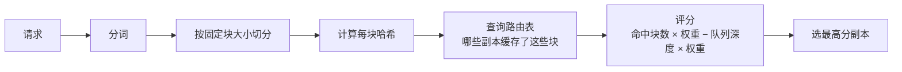

# 第 16 章 路由：缓存感知与队列感知

> LLM 的负载均衡不能轮询。同一个请求发给副本 A 和副本 B，成本可能差一倍，
> 因为 A 命中了前缀缓存，B 要从头 prefill。

## 16.1 三种路由信号

| 信号 | 含义 | 获取方式 | 用途 |
|---|---|---|---|
| 队列深度 | 副本当前排队的请求数 | 引擎指标 | 避免打到最忙的副本 |
| KV 使用率 | 显存中 KV Cache 占比 | 引擎指标 | 接近满时拒绝新请求 |
| 前缀命中 | 请求前缀能在该副本命中多少块 | 块哈希 + 副本缓存索引 | 降低 prefill 成本 |

只用队列深度是"合格"，加上前缀命中才是"省钱"。

## 16.2 路由策略

| 策略 | 说明 | 适用 |
|---|---|---|
| 轮询 | 平均分配 | 无缓存、请求等长（几乎不适用） |
| 最少在途 | 选当前请求最少的副本 | 通用兜底 |
| Power of Two Choices | 随机选两个，取较优 | 大规模、低开销 |
| 前缀感知 | 按块哈希匹配度选副本 | 多轮对话、长系统提示、Agent |
| 会话粘性 | 同一会话固定副本 | 多轮、有状态工具 |
| 租户定向 | 企业客户固定副本组 | 隔离要求 |

〔建议〕**默认"最少在途 + 前缀感知"，会话粘性作为可选，租户定向只给专属部署客户。**

## 16.3 前缀缓存的路由实现

三个工程细节：

1. **块大小要固定**（如 16/32 token），否则哈希无法复用。
2. **路由表要最终一致**：副本缓存淘汰后，路由表可能滞后，导致"以为命中实际没命中"。
   这不会出错，只会退化，可接受。
3. **哈希不能泄露内容**：用带密钥的哈希，避免跨租户探测（第 35 章）。

## 16.4 会话粘性与负载的冲突

多轮对话如果每次都换副本，前缀缓存全部失效。但强粘性会导致热点：某个副本被长会话占满。

折中方案：

| 方案 | 做法 | 代价 |
|---|---|---|
| TTL 粘性 | 同一会话 5~10 分钟内固定副本 | 热点 |
| 软粘性 | 优先选上次副本，但其队列过深时切换 | 少量缓存失效 |
| 分层 | 长会话走专属副本，短请求走共享池 | 容量碎片 |

建议默认**软粘性**：命中优先，过载切换。切换时记录"缓存失效"指标，用于评估收益。

## 16.5 网关的七件事

| 职责 | 说明 | 不做什么 |
|---|---|---|
| 鉴权 | API Key / JWT / mTLS | 不解析业务语义 |
| 限流 | 按租户/Key/模型 | 不做配额结算（只做准入） |
| 路由 | 选副本/选模型版本 | 不做重试编排以外的逻辑 |
| 重试 | 幂等请求、有限预算 | 不重试非幂等写操作 |
| 超时 | 连接/首字节/总时长 | 不代替引擎的超时 |
| 计量 | 记录请求与用量 | 不做账单计算 |
| 审计 | 记录敏感操作 | 不存储业务内容 |

网关是**横切层**，不是业务层。把"生成任务状态机"放进网关，是常见的架构错误。

## 16.6 重试策略

| 场景 | 是否重试 | 说明 |
|---|---|---|
| 连接失败 | 是 | 换副本，指数退避 + 抖动 |
| 429 | 是 | 遵守 `Retry-After` |
| 503 | 是 | 换副本，有限次数 |
| 4xx（参数/鉴权） | 否 | 重试无意义 |
| 流式已输出部分内容 | 否 | 会产生重复内容；返回错误让客户端决定 |
| 非幂等（创建任务） | 否 | 靠幂等键去重 |

重试预算：**单请求总重试次数 ≤ 2，总时长 ≤ 客户端超时**。没有预算的重试会在故障时
放大流量，把小故障变成雪崩。

## 16.7 路由表的模态差异

| 模态 | 路由单位 | 关键信号 | 特殊要求 |
|---|---|---|---|
| LLM | 请求 | 队列、KV、前缀 | 流式连接粘性 |
| 图像 | 单张/批 | 队列长度、卡型 | 按分辨率路由到合适卡 |
| 视频 | 任务 | 预计排队时长、卡数 | 按任务规格匹配副本组 |

视频不适合"请求级"路由，因为一个任务要独占多卡几分钟；它应该在**任务入队时**
就决定去哪组 worker，而不是每个请求再选。

## 16.8 本章结论

- 轮询是错的；默认用"最少在途 + 前缀感知"。
- 会话粘性要软，过载可切换，并度量缓存失效。
- 网关只做横切七件事，业务状态机不进网关。
- 重试必须有预算，流式已输出不重试。

## 决策点（结合自身情况）

1. 是否引入 Gateway API Inference Extension？若引入，锁定风险如何缓解？
2. 前缀缓存的路由表自研还是用引擎自带？自研可控但要维护一致性。
3. 企业客户的"租户定向"是否作为独立 SKU？
