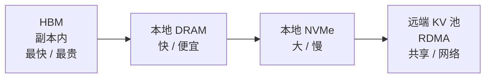
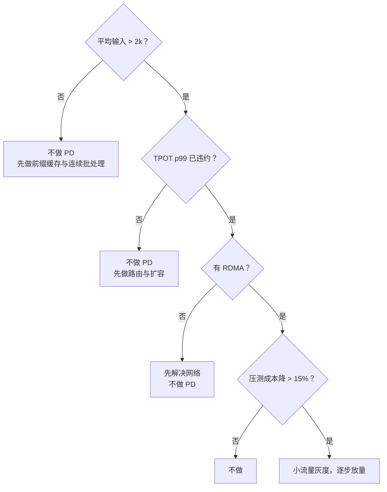

# 第 17 章 PD 分离与 KV 缓存分层

> PD 分离是规模化的优化，不是起步架构。在没有压测证明收益之前，它只会增加故障面。

## 17.1 两种计算的不同画像

| 阶段 | 瓶颈 | 并行特点 | 最优资源 |
|---|---|---|---|
| Prefill | 算力（矩阵乘） | 可大 batch，计算密集 | 高算力卡、大功率 |
| Decode | 显存带宽 | 逐 token，内存密集 | 大显存、高带宽 |

混在一起跑的问题：

- Prefill 的长请求会阻塞 Decode，导致 TPOT 抖动。
- 两者对 batch 的偏好不同，混跑只能取折中。
- 扩缩容只能整体扩，无法按阶段扩。

分离后可以：prefill 池与 decode 池独立扩缩、独立选型、独立调参。

## 17.2 代价

| 代价 | 说明 |
|---|---|
| KV 传输 | prefill 产生的 KV 要传给 decode，走网络 |
| 复杂度 | 两套池、两套调度、两套监控 |
| 故障面 | 任一池故障都影响全链路 |
| 冷启动 | 两个池都要预热 |
| 调试 | 延迟分解变复杂 |

KV 传输量估算：

```
每 token KV 字节 ≈ 2 × 层数 × KV 头数 × 头维度 × 字节宽
70B（80 层，GQA 8 头，128 维，FP16）≈ 320KB/token
生成 1000 tok/s → 320MB/s ≈ 2.6Gbps
生成 10000 tok/s → 3.2GB/s ≈ 26Gbps
```

结论：**低吞吐时普通网络够用；高吞吐必须 RDMA。** 这也是为什么 PD 分离通常与 IB 一起出现。

## 17.3 收益条件

只有同时满足以下条件，PD 分离才可能划算：

| 条件 | 判据（示例） |
|---|---|
| 长 prompt | 平均输入 > 2k token，prefill 占比 > 30% |
| 高并发 | 单副本 decode 已接近带宽瓶颈 |
| 低延迟要求 | TPOT p99 有明确 SLO，混跑无法满足 |
| 有 RDMA | KV 传输不成为新瓶颈 |
| 负载稳定 | 两套池都能维持较高利用率 |
| 有压测 | A/B 显示单位 token 成本下降 > 15% |

少一条，就不要做。尤其是"负载稳定"：如果流量波动大，两套池各自的利用率都会下降，
省下的时间被闲置吃掉。

## 17.4 KV 缓存分层



| 层 | 容量 | 延迟 | 命中收益 | 适用 |
|---|---|---|---|---|
| HBM | 数十 GB | 纳秒 | 最高 | 活跃会话 |
| DRAM | 数百 GB | 微秒 | 高 | 短期复用 |
| NVMe | TB 级 | 百微秒 | 中 | 长文档、长系统提示 |
| 远端 | 池化 | 毫秒 | 视场景 | 跨副本共享前缀 |

关键指标是**命中率**与**每次命中的成本节省**，不是"缓存了多少"。一个命中率 5% 的
远端缓存，可能因为传输开销而亏钱。

## 17.5 压测方法

不要用"吞吐提升了多少"来决策，要用"固定 SLO 下的单位成本"：

```
固定：TTFT p99 ≤ 900ms，TPOT p99 ≤ 60ms
变量：PD 分离 vs 混跑
测量：单位 token 成本、副本数、GPU 利用率、故障率
```

只有在这个口径下，PD 分离的收益才可比。否则容易出现"吞吐高了，但为了满足 p99
反而用了更多卡"的情况。

## 17.6 决策树



## 17.7 落地顺序

如果最终要做，顺序是：

1. 先做**前缀缓存 + 连续批处理**（收益最大、风险最低）。
2. 再做**KV 分层**（本地 DRAM/NVMe），不急上远端。
3. 最后做 **PD 分离**，并且只在长 prompt 场景。
4. 每一步都要有 A/B 和回滚方案。

## 本章结论

- PD 分离解决的是"prefill 阻塞 decode"，不是万能加速。
- 收益依赖长 prompt、高并发、RDMA、稳定负载，缺一不可。
- KV 分层要看命中率与净收益，不是缓存容量。
- 决策口径必须是"固定 SLO 下的单位成本"。

## 决策点（结合自身情况）

1. 你的首个客户场景，平均输入长度是多少？这决定是否值得做 PD。
2. 是否已有 RDMA 网络？若没有，PD 分离应推迟。
3. KV 远端池是自研还是用引擎/框架自带方案？
