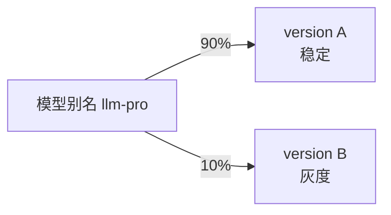

# 第 18 章 弹性、冷启动与发布治理

> 扩容不是"加副本"，是"在 10 分钟后加出能服务的副本"。这 10 分钟决定了你要不要保留最小副本。

## 18.1 用什么指标扩缩容

| 指标 | 含义 | 适用 | 问题 |
|---|---|---|---|
| GPU-Util | 有 kernel 在跑 | 不推荐 | 排队时也 100% |
| 并发请求数 | 在途请求 | LLM | 长请求会高估负载 |
| 队列深度 | 等待请求数 | LLM | 最直接 |
| KV 使用率 | 显存压力 | LLM | 接近满时要扩容或拒绝 |
| TTFT | 首 token 延迟 | LLM | 滞后指标，但最贴近 SLO |
| 队列任务数 | 待处理任务 | 图像/视频 | 要按任务规格分组 |

〔建议〕**LLM 用"队列深度 + KV 使用率"双指标；图像/视频用"队列任务数（按规格分组）"。**
GPU-Util 只用于容量报表，不用于自动扩缩。

## 18.2 冷启动的现实

第 09 章算过，70B 副本冷启动 **5~15 分钟**。这意味着：

| 策略 | 效果 | 成本 |
|---|---|---|
| 保留最小副本 | 吸收突发，扩容只处理增量 | 常驻卡时 |
| 预热池（Paused/占位） | 缩短到 2~5 分钟 | 部分卡时 |
| 权重本地缓存 | 省 2~5 分钟 | 磁盘 |
| 定时预扩 | 应对可预测高峰 | 可能浪费 |
| 预测性扩容 | 应对趋势 | 需要历史数据 |

〔建议〕**付费客户必须保留最小副本；免费流量走共享池，不保证冷启动时间。**

## 18.3 扩容快、缩容慢

```
扩容：队列深度 > 阈值 持续 30s → 立即扩
缩容：队列深度 < 阈值 持续 15min → 缩 1 个
```

缩容慢的三个理由：

1. 在途请求可能还在生成（长输出）。
2. 缓存有价值，缩掉后前缀缓存失效，下一波请求要重新 prefill。
3. 抖动会导致反复扩缩，浪费冷启动成本。

缩容时先摘流量、等在途结束，再终止（第 19 章）。

## 18.4 发布：GPU 稀缺下的滚动更新

常规滚动更新的 `maxSurge=1` 意味着**发布时要多出一整个副本的卡**。对 8 卡副本，
就是多 8 卡；对多模型平台，可能是几十卡。

| 策略 | 配置 | 优点 | 缺点 |
|---|---|---|---|
| 常规滚动 | maxSurge=1, maxUnavailable=0 | 无容量损失 | 需要额外卡 |
| 保守滚动 | maxSurge=0, maxUnavailable=1 | 不额外占卡 | 发布期间容量 -1 |
| 原地升级 | 替换镜像/权重，不重建 Pod | 快，不占额外卡 | 回滚难，状态残留 |
| 蓝绿 | 两套完整环境 | 回滚最快 | 卡翻倍 |

〔建议〕**默认 maxSurge=0、maxUnavailable=1；大客户专属副本用蓝绿；原地升级只在
权重小版本更新时使用。**

原地升级（如 OpenKruise 的 in-place update〔核验〕）能省卡，但要注意：

- 进程要能优雅重启并重新加载权重。
- 回滚只能靠重新下发旧版本，不能靠 ReplicaSet 历史。
- 必须验证"升级后没有残留的旧进程/旧显存"。

## 18.5 灰度与回滚



灰度维度：

| 维度 | 说明 | 风险 |
|---|---|---|
| 按流量比例 | 简单 | 大客户可能被命中 |
| 按租户 | 先内部/试用客户 | 样本偏差 |
| 按请求特征 | 短请求先试 | 实现复杂 |

回滚触发条件要提前定：

- 错误率 > 基线 × 2
- TTFT p99 > SLO
- 人工投诉 > N 条/小时
- 内容安全事件

回滚必须是**一键**的，且要在 5 分钟内完成（切别名，不重建副本）。

## 18.6 LoRA 多租

多个客户共享一个底座，各自加载 LoRA：

| 方案 | 隔离 | 成本 | 适用 |
|---|---|---|---|
| 每租户独立副本 | 强 | 高 | 大客户 |
| 共享副本 + 动态加载 | 中 | 低 | 中小客户 |
| 共享副本 + 预加载多个 LoRA | 中 | 中 | 固定客户群 |

风险：动态加载会带来延迟抖动与显存碎片；LoRA 之间的缓存不能混用。
〔建议〕**首版只做"共享副本 + 预加载固定 LoRA 集合"，不做运行时任意加载。**

## 18.7 发布检查清单

| 项 | 检查 |
|---|---|
| 规格卡 | 新版本是否重新 profiling |
| 容量 | 发布期间容量是否足够（-1 副本） |
| 回滚 | 别名能否一键切回 |
| 缓存 | 旧版本的 KV 缓存是否失效 |
| 计量 | 新版本是否仍能正确计量 |
| 审核/标识 | 是否仍然生效 |
| 监控 | 新版本的指标是否有面板 |

## 本章结论

- 扩缩容看队列与 KV，不看 GPU-Util。
- 冷启动以分钟计，付费客户必须留最小副本。
- GPU 稀缺下默认 maxSurge=0，发布接受 -1 容量。
- 回滚靠别名切换，不靠重建。

## 决策点（结合自身情况）

1. 最小副本的卡时成本由谁承担（平台/客户）？
2. 是否引入原地升级？若引入，回滚演练必须做。
3. LoRA 多租是否作为首版能力？
