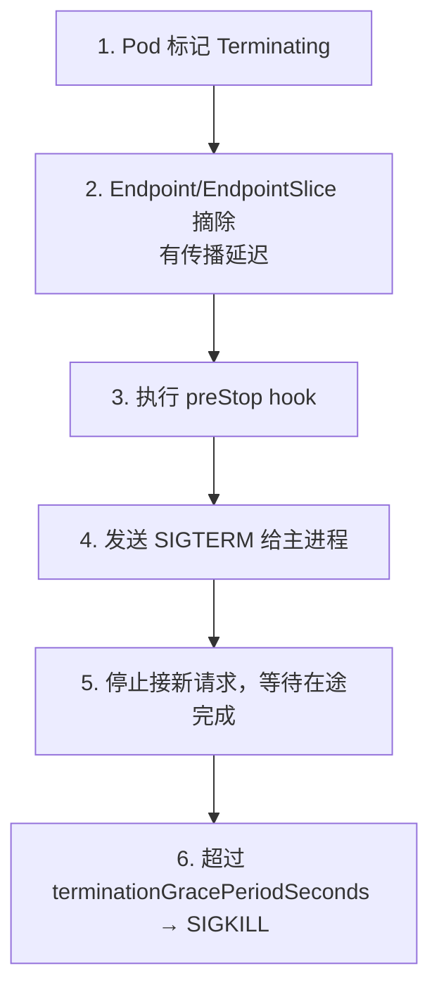
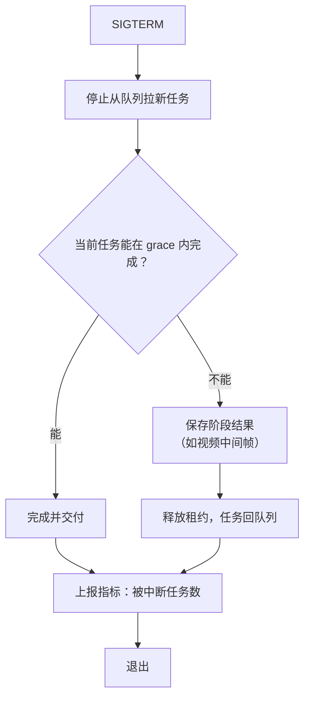

# 第 19 章 优雅退出与过载保护

> 流式生成可能持续几分钟。K8s 默认 30 秒的宽限期，会把"优雅退出"变成"必然截断"。

## 19.1 SIGTERM 全链路



三个容易错的点：

| 点 | 错误做法 | 正确做法 |
|---|---|---|
| 摘流量 | 收到 SIGTERM 才开始拒绝 | 先 unready，等传播，再 SIGTERM |
| 等待 | preStop 里 `sleep 30` | sleep 要覆盖 endpoint 传播延迟（通常 5~15s） |
| 宽限期 | 默认 30s | 按最长生成时间设置 |

## 19.2 宽限期怎么算

```
grace = endpoint 传播延迟
      + 最长在途请求剩余时间
      + 收尾（flush 计量、关闭连接）
      + 缓冲
```

对 LLM：

- 普通对话：最长输出 2k token × 40ms ≈ 80 秒 → grace ≥ 120 秒。
- 长文生成：8k token ≈ 320 秒 → grace ≥ 360 秒。
- Agent 多轮：可能 10 分钟以上 → 要么限制单请求时长，要么用任务制。

对视频任务：单任务可能 30 分钟。**不能靠 grace period 等它跑完**，必须走"停止拉新 +
任务放回队列"（第 25 章）。

〔建议〕LLM 的 grace 设为 **300 秒**，并对单请求设最大生成时长（如 5 分钟）。
超过时长的需求走异步任务或批量接口。

## 19.3 流式连接的退出

流式连接不能"发个错误就断"，要区分三种情况：

| 情况 | 处理 |
|---|---|
| 已输出部分内容，副本要退出 | 发送结束事件（带 `finish_reason=server_shutdown`），让客户端知道可重试 |
| 客户端主动断开 | 取消引擎生成，释放 KV，记账（按已生成 token） |
| 超时 | 同上，返回明确错误码 |

关键：**客户端断开要传导到引擎**。否则 GPU 继续算，用户已经走了，这部分算力是纯浪费。
实现上依赖请求上下文取消（context cancellation）在网关 → 路由 → 引擎全链路传递。

## 19.4 任务型负载的退出



要求：

1. 租约要能**主动释放**，不要等超时（否则任务要等一个租约周期才能重跑）。
2. 重跑要**幂等**：同一个 task_id 重跑不能产生两份账单、两次回调。
3. 阶段结果要能被下一个 worker 复用（视频尤其重要）。

## 19.5 过载保护

过载时最糟的不是拒绝，而是**无限排队**：延迟无限增长，所有请求都超时，资源全浪费。

| 机制 | 做法 | 适用 |
|---|---|---|
| 队列上限 | 每副本/每租户最大排队数 | 全部 |
| 快速拒绝 | 超限立即 429 + `Retry-After` | 全部 |
| 并发信号量 | 限制同时在途请求 | LLM |
| 降级 | 降低最大输出长度/分辨率 | 谨慎，需客户同意 |
| 优先级丢弃 | 先拒绝低优先级 | 多租户 |
| 熔断 | 下游故障时快速失败 | 审核/存储故障 |

〔建议〕**不做"自动降低 max_tokens"这类静默降级。** 客户按参数付费，静默改变输出
等于违约。宁可明确拒绝。

## 19.6 超时预算链

```
客户端超时 (如 600s)
  > 网关总超时 (如 540s)
    > 排队超时 (如 60s)
      > 生成超时 (如 300s)
        > 单 token 超时 (如 30s)
```

每一层都必须小于上一层，否则内层超时永远不触发，外层先断，日志里看不到真实原因。

## 19.7 退出与发布的配合

发布时 `maxUnavailable=1`，意味着每次只杀一个副本。这个副本的退出必须：

1. 不丢在途请求（或明确告知可重试）。
2. 不丢任务（释放租约）。
3. 不让路由继续打进来（unready 先行）。

如果退出做不好，发布就会表现为"每次发布都有少量 5xx"，长期看会侵蚀客户信任。

## 本章结论

- 宽限期要按最长生成时间设置，LLM 建议 300 秒，并对单请求设上限。
- 先 unready 再 SIGTERM，preStop 要覆盖 endpoint 传播延迟。
- 任务型负载靠"停止拉取 + 释放租约 + 幂等重跑"，不靠 grace 等完。
- 过载要快速拒绝，不做静默降级。

## 决策点（结合自身情况）

1. 单请求最大生成时长定多少？这直接影响 grace 与产品形态。
2. 视频任务的中断粒度（整任务 / 阶段）？
3. 是否允许对免费流量做降级（如降低并发）？
