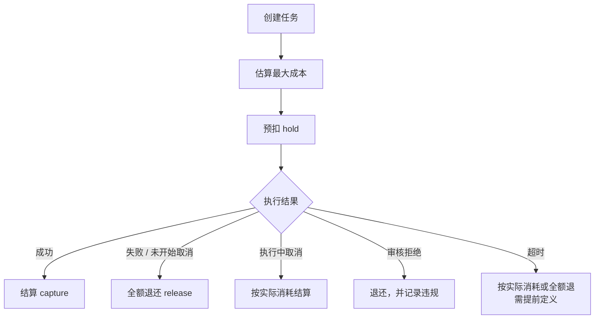

# 第 22 章 视频数据面

> 视频是"重任务"：分钟级、独占多卡、失败要重算。它的接口必须是任务制，
> 它的计费必须预扣，它的抢占必须发生在任务边界。

## 22.1 为什么必须异步

| 特征 | 数值（示意） | 后果 |
|---|---|---|
| 单条耗时 | 3~30 分钟 | HTTP 连接不可靠 |
| GPU 占用 | 4~8 卡独占 | 不能按请求复用 |
| 失败重算 | 分钟级 | 必须能重试且不重复计费 |
| 产物大小 | 10MB~1GB | 需要对象存储与 TTL |
| 参数复杂 | 时长/分辨率/音频/参考 | 需要完整任务记录 |

同步接口只适合"图生视频短片"这类 < 30 秒的场景，且仍建议异步。

## 22.2 任务接口

```
POST   /v1/videos            创建任务 → 202 + task_id
GET    /v1/videos/{id}       查询状态与进度
POST   /v1/videos/{id}/cancel 取消
GET    /v1/videos/{id}/content 获取下载地址（预签名）
```

创建请求：

```json
{
  "model": "video-pro",
  "prompt": "...",
  "duration": 5,
  "resolution": "720p",
  "fps": 24,
  "audio": true,
  "reference_image_url": "https://...",
  "seed": 42,
  "callback_url": "https://customer.example/cb",
  "idempotency_key": "order-12345"
}
```

响应：

```json
{
  "id": "vid_abc",
  "status": "queued",
  "estimated_wait_seconds": 180,
  "estimated_cost": {"unit": "second", "quantity": 5, "amount": 19.0},
  "created_at": "2026-10-27T10:00:00Z"
}
```

## 22.3 参数与成本

| 参数 | 影响 | 成本关系 |
|---|---|---|
| 时长 | 帧数 | 线性 |
| 分辨率 | 像素数 | 超线性（显存与计算） |
| 帧率 | 帧数 | 线性 |
| 音频 | 额外生成/对齐 | 固定增量 |
| 参考视频 | 编码 + 条件注入 | 中等 |
| 精修/超分 | 二次处理 | 显著 |

容量单位：**秒/小时**。不要用"并发任务数"做对外承诺，因为不同分辨率的任务占用差异巨大。

## 22.4 计费：预扣 + 退款



〔建议〕**创建时预扣，失败全额退。** 理由：视频重算成本高，不预扣会被恶意刷；
失败全额退是行业惯例，也是客户能接受的口径。

预扣金额 = 时长 × 分辨率单价 × 数量，向上取整。若实际消耗低于预扣（如提前失败），
差额退回。

## 22.5 交付与保留期

| 项 | 建议 | 说明 |
|---|---|---|
| 交付方式 | 预签名 URL | 不暴露存储凭证 |
| URL TTL | 24 小时 | 可续签 |
| 产物保留 | 7 天〔核验〕 | 行业常见；到期前 24 小时通知 |
| 客户转存 | 提供 API/文档 | 长期存储由客户负责 |
| 删除 | 到期自动清理 + 可手动删除 | 要有删除回执 |

〔核验〕"7 天"来自第三方视频 API 的常见条款，不是标准。运营方必须自己定义，
并在合同中写明，避免客户误以为永久保存。

## 22.6 队列与等待时间

视频不适合承诺延迟，适合承诺**排队时长**：

```
预计等待 = 队列中同规格任务的总卡时 ÷ 可用卡数
```

对外展示"预计等待 X 分钟"，并允许客户选择优先级（加价插队）。这比承诺
"30 分钟内完成"更可控，也更诚实。

## 22.7 抢占边界

视频任务被抢占的代价是"重算几分钟"。三种处理：

| 粒度 | 做法 | 重算量 |
|---|---|---|
| 整任务 | 直接放回队列 | 全部 |
| 分段 | 把长视频拆成 5~10 秒片段，逐段生成后拼接 | 当前段 |
| 阶段检查点 | 保存中间 latent/帧 | 部分 |

〔建议〕**优先"分段 + 拼接"**：既缩短单任务时长（便于抢占与调度），又降低重算成本。
代价是拼接处可能不连贯，需要用重叠帧或参考条件缓解。

## 22.8 常见故障

| 故障 | 原因 | 处理 |
|---|---|---|
| OOM | 高分辨率 + 长时长 | 按规格限制，拆分任务 |
| 超时 | 模型慢/排队久 | 任务级超时 + 重试 |
| 产物损坏 | 编码中断 | 校验 + 重编码 |
| 音画不同步 | 音频轨生成失败 | 分轨处理 + 合成校验 |
| 审核拒绝 | 内容违规 | 明确错误码，退款 |
| 重复回调 | 重试 | 幂等键 |

## 本章结论

- 视频必须任务制，同步只适合极短片段。
- 创建预扣、失败全退，是成本与体验的平衡点。
- 交付走预签名 URL，保留期要自己定义并写进合同。
- 分段生成 + 拼接，是降低抢占代价的关键设计。

## 决策点（结合自身情况）

1. 产物保留 7 天是否合适？存储成本与客户需求的平衡。
2. 是否提供"加价插队"？会影响公平性与收入结构。
3. 分段长度定多少？影响连贯性与抢占粒度。
