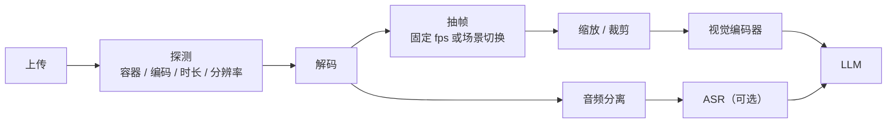

# 第 23 章 多模态理解与内容处理

> 视频理解的瓶颈通常不在模型，而在解码、抽帧和音频分离。这些是 CPU 活，
> 放错地方就会把 GPU 节点拖垮。

## 23.1 上传通道

| 方式 | 适用 | 限制 |
|---|---|---|
| 预签名直传对象存储 | 大文件（视频、批量图） | 需要客户端支持分片 |
| 服务端中转 | 小文件 | 网关内存与带宽压力 |
| base64 内联 | 极小图 | 请求体膨胀，不推荐 |

〔建议〕**> 1MB 一律预签名直传。** 上传完成后客户端把 `object_key` 传给推理接口，
服务端只校验归属与完整性。

上传要做四件事：

1. **大小与类型限制**（按租户配额）。
2. **校验和**（上传时带 sha256，服务端复核）。
3. **病毒/恶意文件扫描**（至少对可执行类型）。
4. **生命周期**（临时文件 24 小时清理）。

## 23.2 媒体处理管线



| 步骤 | 资源 | 耗时特征 |
|---|---|---|
| 探测 | CPU，极轻 | 毫秒 |
| 解码 | CPU（或 GPU 解码） | 接近实时 × 核数 |
| 抽帧 | CPU + 内存 | 与帧数线性 |
| 缩放 | CPU/GPU | 与像素数线性 |
| ASR | GPU/CPU | 与音频时长线性 |
| 视觉编码 | GPU | 与帧数线性 |

一个粗略预算：1 小时 1080p 视频，单路解码约需 1~2 个 CPU 核实时处理；
抽帧到 1fps 约 3600 帧，编码耗时取决于模型。**不要假设"视频理解很便宜"。**

## 23.3 资源隔离

| 组件 | 部署位置 | 理由 |
|---|---|---|
| 解码/抽帧 | 独立 CPU 节点池 | 吃核，不与 GPU 争 |
| 视觉编码器 | GPU 池（可与 LLM 同卡或分离） | 显存与算力 |
| LLM | GPU 池 | 主推理 |
| ASR | 独立池 | 峰值高，可批处理 |

如果解码跑在 GPU 节点上，必须设 CPU limit，否则会把推理进程的 CPU 抢光，
表现为"GPU 利用率正常但 TTFT 抖动"。

## 23.4 编码器与 LLM 分离

两种架构：

| 架构 | 优点 | 缺点 |
|---|---|---|
| 端到端（编码器 + LLM 同进程） | 延迟低、部署简单 | 显存耦合、扩缩容不独立 |
| 分离（编码器服务 → 向量/Token → LLM） | 独立扩缩、可复用 | 传输开销、两套服务 |

〔建议〕**首版端到端，规模上来后分离。** 分离的前提是编码器输出可以高效传输
（向量或 token），且两边的 batch 策略能匹配。

## 23.5 缓存

多模态的缓存要按**内容哈希**，不是按文本：

```
cache_key = sha256(媒体文件) + 处理参数（抽帧率、分辨率、模型版本）
```

| 缓存对象 | 收益 | 风险 |
|---|---|---|
| 解码后的帧 | 重复分析同一视频 | 存储大 |
| 视觉 embedding | 相同素材多次查询 | 中等 |
| ASR 文本 | 相同音频 | 小 |
| LLM 前缀 KV | 相同系统提示 + 素材 | 显存 |

跨租户共享缓存必须谨慎：即使内容相同，也可能涉及隐私。默认**按租户隔离**，
只对"公开素材"开放共享。

## 23.6 长视频策略

| 策略 | 做法 | 适用 |
|---|---|---|
| 均匀抽帧 | 固定 fps | 通用摘要 |
| 场景切换抽帧 | 检测镜头变化 | 叙事视频 |
| 分段 + 聚合 | 每段摘要，再汇总 | 超长视频 |
| 关键帧 + 音频 | 视觉稀疏 + 音频密集 | 讲座、会议 |

分段聚合要注意**时间戳对齐**：客户问"第 3 分钟发生了什么"，系统要能定位到片段。

## 23.7 失败处理

| 失败 | 处理 |
|---|---|
| 容器损坏 | 返回明确错误，不重试 |
| 编码不支持 | 尝试转码，失败则报错 |
| 文件过大 | 拒绝或要求分段 |
| 解码超时 | 降采样或拒绝 |
| 音频缺失 | 仅视觉理解，标注"无音频" |
| 内容违规 | 审核拒绝，按策略计费 |

## 本章结论

- 大文件走预签名直传，服务端只做校验。
- 解码与抽帧是 CPU 密集，必须独立节点池并设 limit。
- 缓存按内容哈希，跨租户默认隔离。
- 长视频用分段 + 聚合，并保留时间戳。

## 决策点（结合自身情况）

1. 是否自建 ASR，还是调用外部服务？涉及数据出境与成本。
2. 编码器与 LLM 何时分离？取决于并发与显存压力。
3. 视频理解的计价单位（每分钟 / 每千帧）？
