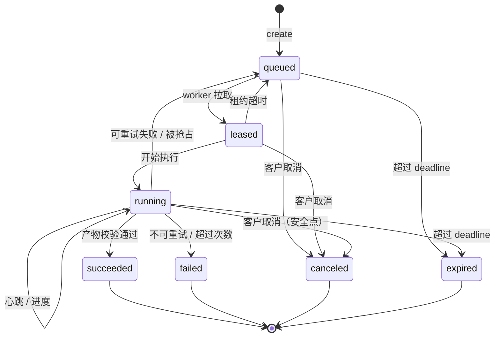
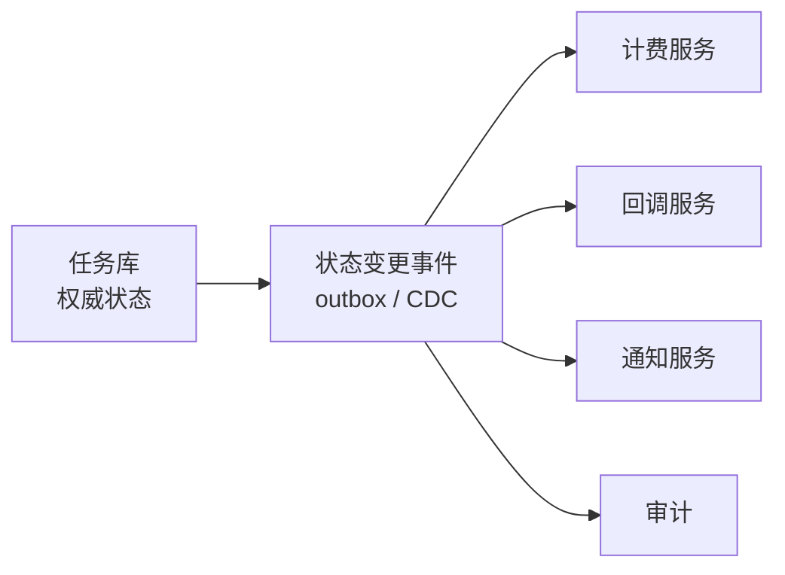

# 第 24 章 任务模型与状态机

> 任务状态不能只存在推理实例的内存里。实例会被 kill、被抢占、被滚动更新，
> 状态必须有一个中心的、可恢复的权威副本。

## 24.1 状态定义

| 状态 | 含义 | 是否终态 |
|---|---|---|
| `queued` | 已接受，等待 worker | 否 |
| `leased` | 已被某个 worker 领取，尚未开始执行 | 否 |
| `running` | 执行中，定期上报进度 | 否 |
| `succeeded` | 完成且产物已校验 | 是 |
| `failed` | 执行失败且不再重试 | 是 |
| `canceled` | 客户取消 | 是 |
| `expired` | 超过截止时间未完成 | 是 |



取消可以从 `queued`/`leased`/`running` 进入 `canceled`，但 `running` 的取消是
**协作式**的：worker 在安全点检查取消标志，不能强杀（否则产物损坏）。

## 24.2 转换表

| 从 | 到 | 触发 | 副作用 |
|---|---|---|---|
| — | queued | 创建（幂等键去重） | 预扣、入队 |
| queued | leased | worker 拉取 | 写租约、attempt++ |
| leased | running | worker 上报开始 | 记录开始时间 |
| leased | queued | 租约超时 | 释放租约、退避 |
| running | running | 心跳/进度 | 更新 progress、续租 |
| running | succeeded | 产物校验通过 | 结算、回调、标识 |
| running | queued | 可重试失败/被抢占 | 记录原因、退避 |
| running | failed | 不可重试/超过次数 | 退款、回调 |
| queued/leased/running | canceled | 客户取消 | 退款/按实际计费 |
| queued/running | expired | 超过 deadline | 退款、回调 |

## 24.3 任务字段

| 字段 | 说明 |
|---|---|
| `task_id` | 全局唯一，不可猜测 |
| `tenant_id` / `project_id` | 归属 |
| `idempotency_key` | 客户端提供，租户内唯一 |
| `type` | `image` / `video` / `batch` / `llm_async` |
| `params` | 模态相关参数（JSON），创建后不可变 |
| `priority` | 队列优先级 |
| `deadline` | 绝对时间，超时即 expired |
| `attempt` / `max_attempts` | 重试控制 |
| `lease` | 当前租约（worker、到期时间） |
| `progress` | 0~100 + 阶段描述 |
| `outputs` | 产物引用（对象存储 key、哈希、大小） |
| `callback_url` | 回调地址（可空） |
| `billing_state` | 见第 27 章 |
| `created_at` / `updated_at` | 时间 |

`params` 不可变很重要：重试时不能因为参数被改而生成不同结果。

## 24.4 幂等

```
唯一约束：(tenant_id, idempotency_key)
```

| 情况 | 行为 |
|---|---|
| 键不存在 | 创建任务，返回 202 |
| 键存在，参数哈希相同 | 返回已有任务（200/202） |
| 键存在，参数哈希不同 | 返回 409，明确告知冲突 |

参数哈希要包含 `type + params + model_version`，不包含 `callback_url`（允许更新回调）。

## 24.5 进度上报

- `progress` 是**给人看的**，不是调度依据。
- 上报频率限制（如 1 次/5 秒），避免写放大。
- 阶段化描述比百分比更有用：`"diffusing 12/50"`、`"encoding"`、`"uploading"`。
- 进度回退要忽略（防止乱序覆盖）。

## 24.6 状态权威与事件



不要用"worker 直接调计费/回调"的方式，因为 worker 可能崩溃在两次调用之间。
用**事务性 outbox**：状态变更与事件写入同一事务，异步投递。

## 24.7 保留与清理

| 数据 | 保留 | 说明 |
|---|---|---|
| 任务记录 | 90 天（可配） | 支撑对账与客服 |
| 产物 | 7 天（视频）/ 24 小时（图像） | 客户可转存 |
| 日志 | ≥ 6 个月〔核验〕 | 合规 |
| 已取消任务 | 30 天 | 便于排查 |

## 本章结论

- 状态权威在中心库，worker 只上报；事件用 outbox 投递。
- 幂等键 + 参数哈希，能同时解决重复提交与参数冲突。
- 取消是协作式的，不能强杀。
- 任务记录与产物保留期要分开定义。

## 决策点（结合自身情况）

1. 任务记录保留 90 天是否足够？客服与对账需求。
2. `deadline` 是客户指定还是平台按优先级计算？
3. 是否支持"暂停/恢复"？会增加状态复杂度，首版不建议。
