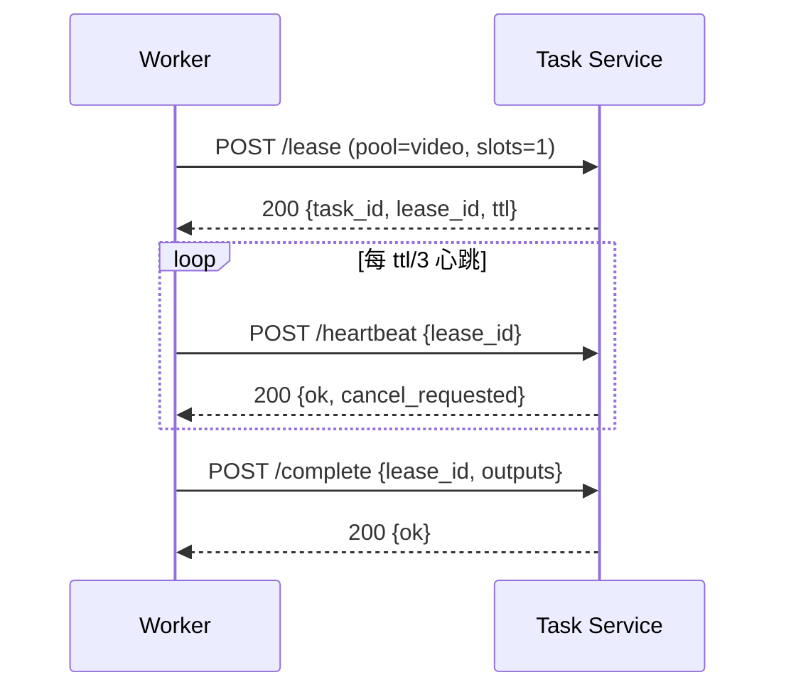

# 第 25 章 租约、拉取与背压

> 中心推任务给 worker，会同时失去背压和故障感知。让 worker 主动拉，问题少一半。

## 25.1 推 vs 拉

| 维度 | 推（master → worker） | 拉（worker → master） |
|---|---|---|
| 背压 | 需要额外机制 | 天然：忙就不拉 |
| worker 故障 | master 不知道，继续推 | 租约超时，自动重排 |
| 扩缩容 | master 要感知 worker 列表 | worker 起来就拉 |
| 负载均衡 | master 要决策 | worker 自取 |
| 实现复杂度 | 高 | 低 |

〔建议〕**worker 拉取。** 中心只维护队列与租约，不维护"哪个 worker 在跑什么"的实时视图
（租约表本身就是视图）。

## 25.2 租约协议



| 参数 | 建议值 | 说明 |
|---|---|---|
| `ttl` | 60~120 秒 | 视频可更长（300 秒） |
| 心跳间隔 | ttl / 3 | 留两次失败重试 |
| 续租上限 | 任务 deadline | 不能无限续 |
| 租约超时判定 | 服务端时间 | 避免 worker 时钟漂移 |

## 25.3 租约超时与重入队

```
租约到期未续 → 任务回到 queued，attempt++，退避（如 30s × 2^n）
attempt > max → failed（或 dead letter）
```

三个细节：

1. **幂等**：重跑可能已经产生了副作用（上传了产物、发了回调），必须能识别并复用/覆盖。
2. **僵尸 worker**：网络分区恢复后，旧 worker 可能还在跑。完成时要校验 `lease_id`
   是否仍是当前租约，不是则丢弃结果。
3. **时钟**：所有超时以服务端时间为准；worker 只负责按时心跳。

## 25.4 背压

worker 只在"有空闲槽位"时拉取：

```
slots = 本机可用 GPU 数 ÷ 任务所需 GPU 数
```

好处：

- 不会把任务拉到一个已经满载的节点。
- 队列深度天然反映真实积压。
- 扩缩容只需要看队列深度与 worker 数。

长轮询（long-poll）可以减少空拉：没有任务时挂起 20~30 秒，有任务立即返回。

## 25.5 任务与 worker 的匹配

| 任务属性 | worker 属性 | 匹配方式 |
|---|---|---|
| 模态（image/video） | 池标签 | 队列隔离 |
| 需要 GPU 数 | 可用 GPU 数 | 资源匹配 |
| 最小显存 | 卡型 | 规格标签 |
| 精度/引擎版本 | 镜像标签 | 版本匹配 |
| 优先级 | 池优先级 | 队列优先级 |

匹配在**服务端**做（选择哪个队列），不在 worker 端做（worker 只声明自己能干什么）。
否则每个 worker 都要理解全部任务类型。

## 25.6 重试策略

| 失败类型 | 是否重试 | 退避 |
|---|---|---|
| worker 崩溃/租约超时 | 是 | 指数 + 抖动 |
| OOM | 是（降规格） | 立即，最多 1 次 |
| 超时 | 是（一次） | 指数 |
| 参数错误 | 否 | — |
| 内容审核拒绝 | 否 | — |
| 产物校验失败 | 是（一次） | 立即 |
| 平台内部错误 | 是 | 指数 |

**毒任务**（连续失败且非上述类型）进 dead letter queue，人工排查，不再自动重试。

## 25.7 扩缩容

```
目标 worker 数 = ceil(队列深度 ÷ 单 worker 吞吐) + 冗余
```

- 扩容要提前（冷启动分钟级），所以用"队列深度 + 趋势"而不是"当前积压"。
- 缩容要慢（空闲 15 分钟），避免抖动。
- 视频 worker 的"吞吐"是任务/小时，不是请求/秒。

## 25.8 本章结论

- 拉取模型天然有背压与故障恢复，优于推送。
- 租约要有 TTL、心跳、幂等重入队、僵尸防护。
- 任务与 worker 的匹配在服务端做。
- 毒任务要隔离，不能无限重试。

## 决策点（结合自身情况）

1. 租约 TTL 按模态分别设，还是统一？
2. 最大重试次数（3 次 / 5 次）？
3. 是否支持"任务迁移"（把长任务从一个 worker 迁到另一个）？首版不做。
