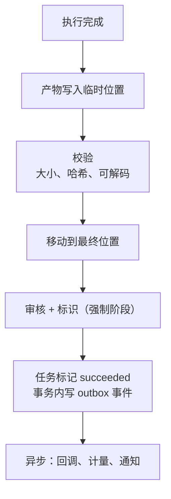
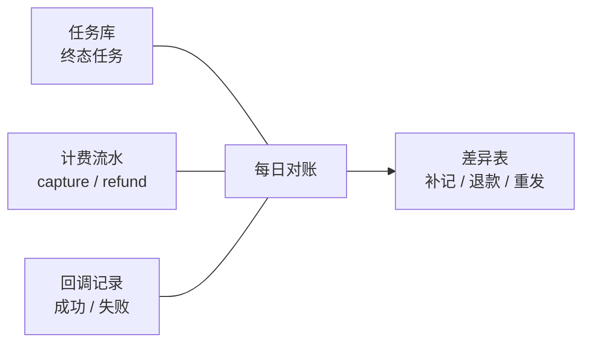

# 第 26 章 交付、回调与对账

> 回调不是"发个 HTTP 请求"，而是一份至少一次投递、可验证、可重放、可对账的契约。

## 26.1 交付顺序



**必须先校验再回调**。反过来会出现"客户收到成功回调，下载到损坏文件"，比直接失败更糟。

## 26.2 回调契约

```http
POST /customer/callback
Content-Type: application/json
X-Event-ID: evt_01J...
X-Timestamp: 1760000000
X-Signature: sha256=hex(HMAC(secret, timestamp + "." + body))
X-Task-ID: vid_abc

{
  "event": "task.succeeded",
  "task_id": "vid_abc",
  "status": "succeeded",
  "outputs": [
    {"type": "video", "url": "https://...", "expires_at": "...", "sha256": "..."}
  ],
  "usage": {"unit": "second", "quantity": 5},
  "occurred_at": "2026-10-27T10:05:00Z"
}
```

| 安全项 | 作用 |
|---|---|
| HMAC 签名 | 防伪造 |
| 时间戳 | 防重放（建议 ±5 分钟） |
| 事件 ID | 接收方幂等去重 |
| 任务 ID | 关联 |

签名密钥按租户独立，支持轮换（新旧密钥并行验证一段时间）。

## 26.3 重试

| 次数 | 间隔 | 累计 |
|---|---|---|
| 1 | 1 分钟 | 1 分钟 |
| 2 | 5 分钟 | 6 分钟 |
| 3 | 30 分钟 | 36 分钟 |
| 4 | 2 小时 | ~2.6 小时 |
| 5 | 6 小时 | ~8.6 小时 |
| 6 | 24 小时 | ~32 小时 |

- 2xx 视为成功；4xx（除 408/429）视为永久失败，停止重试并告警。
- 超过总时限（如 24 小时）标记 `callback_failed`，进入人工/对账流程。
- 重试要带同样的 `X-Event-ID`，便于接收方去重。

## 26.4 SSRF 防护

回调地址是用户输入的，必须防 SSRF：

| 检查 | 做法 |
|---|---|
| 协议 | 只允许 https（内部测试可 http） |
| 域名 | 解析后检查 IP，禁止私有网段、回环、链路本地 |
| 重定向 | 不跟随，或跟随后再校验 |
| 端口 | 只允许 443（或白名单） |
| DNS 重绑定 | 解析与连接使用同一 IP（pin） |
| 超时 | 连接 5 秒，总 10 秒 |

不做的后果：客户可以用回调地址探测你的内网。

## 26.5 查询兜底

回调不可靠（客户防火墙、地址变更），必须保留主动查询：

```
GET /v1/tasks/{id}
→ status, progress, outputs (预签名 URL), error
```

客户可以：
- 收到回调后查询确认。
- 没收到回调时轮询。
- 用 `updated_at` 做增量同步。

## 26.6 对账

每天跑一次三方对账：



| 差异 | 含义 | 处理 |
|---|---|---|
| 任务成功但无计费 | 漏账 | 补记，标记来源 |
| 有计费但任务失败 | 多收 | 退款 |
| 任务成功但回调失败 | 客户不知道 | 重发或人工通知 |
| 回调成功但任务失败 | 状态错乱 | 排查 outbox 投递 |

对账结果要留档，差异率超过阈值（如 0.1%）要告警。

## 26.7 预签名 URL 的规则

| 规则 | 说明 |
|---|---|
| 最小权限 | 只读、只对单个对象 |
| 短 TTL | 15 分钟~24 小时，按场景 |
| 不透明 | 不暴露桶名/路径结构（可用 CDN 域名） |
| 可撤销 | 删除对象即失效 |
| 不计入长期凭证 | 服务本身不持有客户长期密钥 |

## 本章结论

- 先校验再回调，顺序不能反。
- 回调要签名、带事件 ID、指数退避、永久失败告警。
- 回调地址必须做 SSRF 防护。
- 查询兜底与每日对账，是回调可靠性的最后一道防线。

## 决策点（结合自身情况）

1. 回调总重试时限（24 小时 / 72 小时）？
2. 是否支持 webhook 密钥自助轮换？
3. 对账差异的自动修复边界在哪里（哪些必须人工）？
