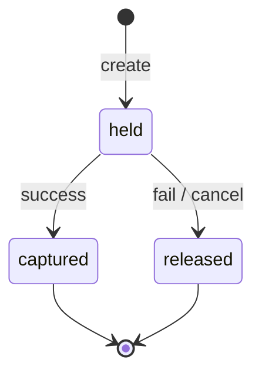

# 第 27 章 计费联动：预扣、退款与幂等

> 计费最难的不是算钱，而是"任务状态变了，钱有没有跟着变，且只变一次"。

## 27.1 三个动作

| 动作 | 时机 | 效果 |
|---|---|---|
| `hold`（预扣） | 创建任务/开始生成 | 冻结额度，不产生收入 |
| `capture`（结算） | 任务成功 | 冻结转实收 |
| `release`（释放） | 失败/取消 | 解冻，全额或部分退回 |

对 LLM 这类短请求，可以简化为"完成后直接 capture"；对视频这类长任务，必须 hold。

## 27.2 计费状态机



| 任务终态 | 计费动作 | 说明 |
|---|---|---|
| succeeded | capture | 按实际用量 |
| failed（平台原因） | release | 全额退 |
| failed（客户参数/内容违规） | release 或按策略 | 需合同写明 |
| canceled（未开始） | release | 全额退 |
| canceled（执行中） | capture 实际消耗 | 按已用卡时/已生成部分 |
| expired | release | 平台未在 deadline 完成 |

〔建议〕**平台原因一律全额退；客户原因（参数错误、内容违规）不计费但记录；
执行中取消按实际消耗计费。** 这三条要写进 SLA 与用户协议。

## 27.3 幂等

```
唯一键：billing_event_id = f(task_id, phase)
phase ∈ {hold, capture, release, refund}
```

- 同一 `(task_id, phase)` 只能成功一次。
- 重复投递（outbox 重试）被唯一约束拦截。
- 金额变更（如部分退款）用新的 `refund` 事件，不修改历史事件。

**账本只追加，不修改。** 任何修正都通过新事件表达，保证可审计。

## 27.4 与任务状态的原子性

```
BEGIN
  UPDATE task SET status='succeeded', ...
  INSERT INTO outbox (event='task.succeeded')
COMMIT
  → 异步消费者：capture + callback + metering
```

- 任务状态与 outbox 同事务，保证"状态变了，事件一定在"。
- 计费消费者幂等，保证"事件重复，钱只扣一次"。
- 不要用"worker 直接调计费 API"，因为崩溃会导致状态与账不一致。

## 27.5 预扣金额

```
视频：hold = 时长 × 分辨率单价 × 数量
图像：通常不 hold，完成后 capture
LLM：按 max_tokens 估算 hold（可选），完成后按实际 capture
```

预扣过高会占用客户额度，过低会透支。建议按"最大可能消耗"预扣，完成后立即释放差额。

## 27.6 信用与额度

| 机制 | 作用 |
|---|---|
| 额度上限 | 防止透支 |
| 余额不足 | 拒绝新任务（402/429） |
| 负余额 | 允许小幅透支（如 5%），超过即停 |
| 自动充值 | 可选 |
| 大客户后付 | 合同约定，单独风控 |

额度检查要在**创建任务时**做，不要在 worker 执行时做（否则任务已消耗算力却收不到钱）。

## 27.7 批量与部分成功

批量任务（如 100 张图）可能部分成功：

| 语义 | 计费 |
|---|---|
| 整批成功才计费 | 部分失败则全退，平台承担 |
| 按实际成功计费 | 推荐，公平 |

按实际成功计费要求任务记录里保留每一条的结果，不能只存汇总。

## 27.8 对账与争议

| 场景 | 处理 |
|---|---|
| 客户说"没收到服务" | 查任务状态 + 回调记录 + 产物存在性 |
| 客户说"重复扣费" | 查 billing_event_id 唯一性 |
| 客户说"用量不对" | 查 usage 事件与引擎日志 |
| 退款 | 生成 refund 事件，不删除原 capture |

争议处理要有**时限**（如 30 天）与**证据包**（任务记录、用量、回调、日志）。

## 27.9 一个完整序列

```
10:00:00  create task → hold 19.00 元
10:00:01  queued
10:00:30  leased
10:00:31  running
10:03:20  succeeded（产物校验通过）
10:03:20  capture 19.00 元（实际 5 秒 × 3.8）
10:03:21  callback 成功
10:03:22  usage 事件入账
```

若在 10:02 失败：

```
10:02:00  failed（平台 OOM）
10:02:00  release 19.00 元
10:02:01  callback(task.failed)
```

## 本章结论

- 长任务必须 hold，成功后 capture，失败 release。
- 账本只追加，幂等靠唯一键，状态与事件同事务。
- 退款口径要写进合同，不能事后解释。
- 对账与争议处理要有证据包与时限。

## 决策点（结合自身情况）

1. 客户原因失败是否计费？蓝本建议不计费但记录。
2. 执行中取消按什么粒度计费（卡时/已生成秒数/固定比例）？
3. 是否允许负余额？阈值多少？
