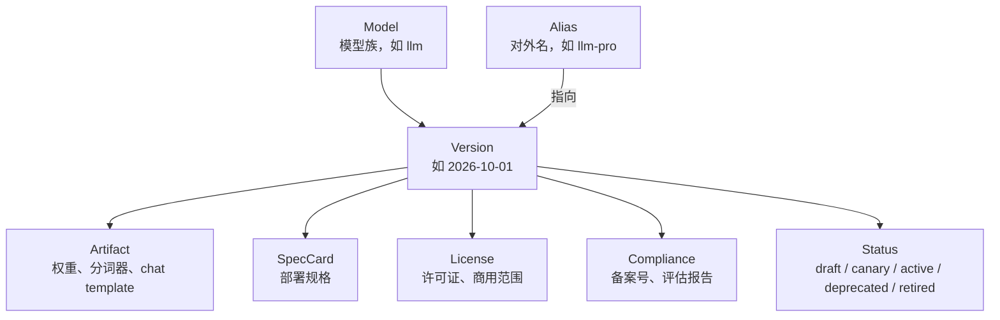
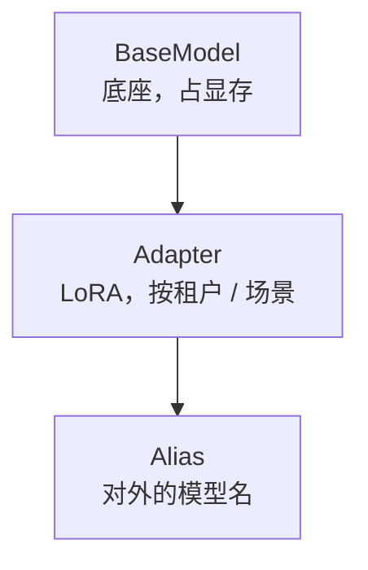

# 第 28 章 模型目录与准入

> 客户调用的是别名，不是权重文件。别名背后可以换版本、换引擎、换量化，
> 但能力与价格必须可预期。

## 28.1 目录的数据模型

| 对象 | 谁维护 | 变化频率 |
|---|---|---|
| Model | 模型团队 | 低 |
| Version | 模型团队 + 平台 | 每月 |
| SpecCard | 平台 | 每版本 |
| Alias | 产品 | 按发布 |
| License/Compliance | 法务/合规 | 每次上架 |

## 28.2 上架准入清单

| # | 项 | 不通过的样子 |
|---|---|---|
| 1 | 权重来源可追溯（哈希、签名） | 不知道文件从哪来 |
| 2 | 许可证允许商用 | 上线后被投诉 |
| 3 | 安全评估完成 | 备案材料缺项 |
| 4 | 效果回归通过 | 上线后效果变差 |
| 5 | 性能基线（规格卡） | 无法做容量规划 |
| 6 | 分词器/chat template 哈希记录 | 对话格式漂移 |
| 7 | 标识与审核接入 | 合规红线 |
| 8 | 计量字段验证 | 账单算错 |
| 9 | 回滚方案 | 出事无法切回 |
| 10 | 文档与示例 | 客户不会用 |

## 28.3 效果回归：最容易漏的四项

线上"效果变差"常常不是模型本身，而是周边不一致：

| 项 | 症状 | 检查 |
|---|---|---|
| chat template | 对话角色错乱、系统提示失效 | 哈希比对 + 固定对话测试 |
| tokenizer | 截断位置错、token 计数错 | 与训练侧同版本 |
| 量化精度 | 长文推理退化、工具调用失败 | 固定题集对比 FP16 基线 |
| 工具解析器 | 参数缺失、JSON 解析失败 | 端到端工具调用用例 |

〔建议〕**每次上架必须跑"周边四件套"回归，哪怕权重没变。** 因为引擎升级也可能改变
template 的渲染方式。

## 28.4 别名与版本策略

| 策略 | 说明 | 适用 |
|---|---|---|
| 浮动别名 | `llm-pro` 永远指向最新稳定版 | 大多数客户 |
| 固定版本 | `llm-pro@2026-10-01` | 对稳定性要求高的客户 |
| 灰度别名 | `llm-pro-canary` | 内部/试用 |
| 退役别名 | 只读，返回 410 | 下线过渡 |

弃用周期建议 ≥ 6 个月，并提前 90 天通知。通知要包含：替代版本、差异、迁移指南。

## 28.5 灰度与回滚

| 阶段 | 流量 | 观察指标 | 退出条件 |
|---|---|---|---|
| canary | 5% | 错误率、TTFT、投诉 | 24 小时无异常 |
| ramp | 50% | 同上 + 成本 | 24 小时 |
| active | 100% | 全部 | — |

回滚 = 把别名指回上一版本，不重建副本（第 18 章）。要求 5 分钟内完成。

## 28.6 多 LoRA 的目录表达

LoRA 作为 Model 的一种，但共享底座：

目录要能表达"这个别名需要底座 X + 适配器 Y"，路由时据此选择副本。

## 28.7 本章结论

- 目录的核心是"别名 → 版本 → 规格/许可/合规"的链路。
- 上架准入必须包含周边四件套回归，不只是权重。
- 灰度靠别名切流，回滚不重建副本。
- 弃用要有周期与迁移指南。

## 决策点（结合自身情况）

1. 是否对外暴露固定版本号？会限制内部升级自由。
2. 效果回归的题集由谁维护、多久更新？
3. LoRA 是否作为独立 SKU 定价？
