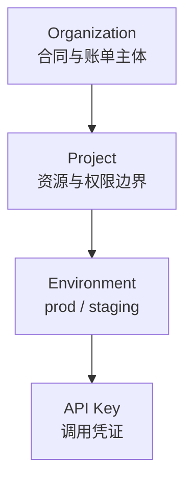

# 第 30 章 身份、租户与密钥

> 租户不是一个字段，而是四条隔离线：数据、缓存、配额、日志。少一条，迟早出事。

## 30.1 四层结构

| 层 | 作用 | 关键约束 |
|---|---|---|
| Organization | 计费、发票、合规主体 | 一个 org 一个信用额度 |
| Project | 配额、模型白名单、成员 | 跨 project 默认不可见 |
| Environment | 隔离测试与生产 | 测试流量不计费或单独计价 |
| API Key | 调用凭证 | 最小权限、可轮换 |

## 30.2 角色

| 角色 | 权限 |
|---|---|
| Owner | 全部，含删除 org、转移所有权 |
| Admin | 成员、Key、项目、配额 |
| Developer | 创建 Key、调用、查看用量 |
| Billing | 账单、发票、充值 |
| Viewer | 只读 |

权限矩阵要落到 API 层，不能只在前端隐藏按钮。

## 30.3 API Key 设计

| 项 | 做法 |
|---|---|
| 格式 | `sk_live_<随机 32+ 字符>`，前缀标明环境 |
| 存储 | 只存哈希（加 pepper），不存明文 |
| 展示 | 创建时展示一次，之后不可见 |
| 作用域 | 模型白名单、端点白名单、只读/读写 |
| 有效期 | 默认 90 天，可设长期 |
| IP 白名单 | 企业客户可选 |
| 轮换 | 新旧并行 7 天，之后旧 Key 失效 |
| 吊销 | 立即生效，缓存 TTL ≤ 60 秒 |

密钥泄露的处置流程要预先写好：吊销 → 查用量异常 → 通知 → 复盘。

## 30.4 四条隔离线

| 隔离 | 要求 | 实现 |
|---|---|---|
| 数据 | 任务、产物、日志按租户隔离 | 行级 tenant_id + 对象存储前缀 |
| 缓存 | 前缀缓存/KV 不跨租户 | 按租户命名空间或独立副本 |
| 配额 | 限额独立 | 配额服务按 tenant/project |
| 日志 | 查询与导出按租户过滤 | 日志索引带 tenant_id |

其中**缓存隔离最容易被忽略**。前缀缓存命中会让首 token 变快，攻击者可能据此推断
他人 prompt 的内容（时间侧信道）。缓解：

1. 缓存键加租户盐（但要确认引擎实现真的隔离〔核验〕）。
2. 高敏感客户用独立副本。
3. 关闭跨租户共享缓存。

〔核验〕部分引擎文档明确不建议依赖某些参数做租户隔离，选型时要逐条确认。

## 30.5 认证方式

| 场景 | 方式 |
|---|---|
| 服务端调用 | API Key（Bearer） |
| 控制台 | OIDC/SSO + MFA |
| 企业专线 | mTLS 或私有链接 |
| 临时凭证 | STS/短期 token（如前端直传对象存储） |

前端永远不要持有长期 API Key。需要前端调用的场景，用后端签发的短期 token。

## 30.6 审计

必须记录的事件：

| 事件 | 字段 |
|---|---|
| 登录/失败 | 用户、IP、UA、结果 |
| Key 创建/吊销/轮换 | 操作人、Key 前缀、作用域 |
| 配额变更 | 旧值、新值、操作人 |
| 模型上架/下线 | 版本、操作人 |
| 关闭显式标识 | 任务、客户、用途 |
| 数据导出/删除 | 范围、操作人、回执 |

审计日志只追加，保留 ≥ 6 个月〔核验〕。

## 30.7 客户离场

| 步骤 | 要求 |
|---|---|
| 吊销 Key | 立即 |
| 停止计费 | 当日 |
| 导出数据 | 提供任务记录与产物下载 |
| 删除数据 | 按合同期限，提供回执 |
| 归档审计 | 按法规保留 |

离场流程要在合同里写清，否则会被"删不干净"或"要价过高"卡住。

## 本章结论

- 租户是四条隔离线，不只是数据库字段。
- Key 只存哈希、可轮换、可吊销、最小作用域。
- 缓存隔离是隐藏风险，必须逐引擎确认。
- 离场流程要提前设计。

## 决策点（结合自身情况）

1. Key 默认有效期 90 天是否会影响客户体验？
2. 是否为高敏感客户提供独立副本（成本转嫁）？
3. 审计日志保留期限与存储方案。
