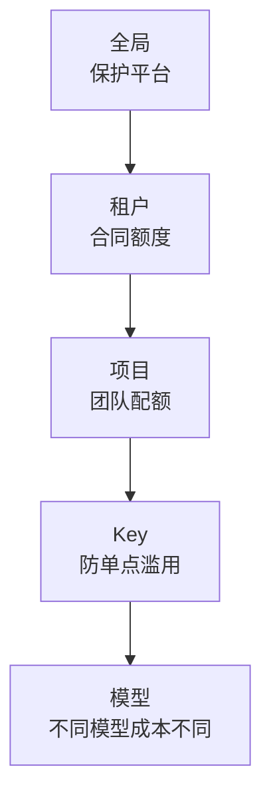

# 第 31 章 限流、公平与配额

> 限流不是"挡住请求"，而是"在过载时让该成功的请求成功"。

## 31.1 限流单位

| 单位 | 适用 | 说明 |
|---|---|---|
| RPM | 全部 | 请求数/分钟，防高频小请求 |
| TPM | LLM | token/分钟，贴近成本 |
| 并发请求数 | LLM | 防长请求占满 |
| 上下文长度上限 | LLM | 防单请求吃满显存 |
| 任务数/日 | 图像/视频 | 防批量刷 |
| GPU 秒/日 | 视频 | 贴近成本 |
| 存储/出网 | 全部 | 防下载滥用 |

〔建议〕**LLM 用 TPM + 并发 + 单请求上下文上限三件套；视频用 GPU 秒/日 + 并发任务数。**
只用 RPM 会被"一个请求生成 10 万 token"打穿。

## 31.2 算法

| 算法 | 特点 | 适用 |
|---|---|---|
| 令牌桶 | 允许突发 | TPM、RPM |
| 漏桶 | 平滑输出 | 下游保护 |
| 滑动窗口 | 精确但需存储 | 精确配额 |
| 并发信号量 | 控制同时在途 | LLM |
| 队列 + 公平调度 | 控制等待 | 视频任务 |

分布式实现：Redis + Lua 原子脚本，或网关本地计数 + 周期同步（允许少量超额）。

## 31.3 分层限流

任何一层超限都拒绝，返回该层的 `Retry-After`。

## 31.4 公平

限流解决"不被打垮"，公平解决"不被一个大客户占满"。

| 机制 | 作用 |
|---|---|
| 预留份额 | 小客户保底 |
| 加权公平队列 | 按合同权重分配 |
| 最大占用上限 | 单租户不超过总量 X% |
| 优先级队列 | 付费客户优先 |

〔建议〕**共享池设"单租户最大占用 30%"上限**，防止一个大客户在高峰期挤占所有人。

## 31.5 过载行为

| 情况 | 行为 | 响应 |
|---|---|---|
| 超过 TPM | 拒绝 | 429 + `Retry-After` |
| 并发已满 | 拒绝或短排队 | 429 或 202（任务） |
| 队列已满 | 拒绝 | 429 |
| 余额不足 | 拒绝 | 402 |
| 平台故障 | 快速失败 | 503 |

不要"无限排队"：延迟会无限增长，最终所有请求都超时，资源全浪费。

## 31.6 默认限额（示例）

| 等级 | RPM | TPM | 并发 | 视频并发 |
|---|---|---|---|---|
| Free | 20 | 20k | 2 | 0 |
| Basic | 300 | 300k | 16 | 2 |
| Pro | 2000 | 2M | 64 | 10 |
| Enterprise | 合同 | 合同 | 合同 | 合同 |

这些数字必须与容量模型对齐：**所有 Pro 客户同时打满时，平台要能撑住或明确降级**。

## 31.7 配额与限流的区别

| 概念 | 时间尺度 | 作用 |
|---|---|---|
| 限流 | 秒/分钟 | 保护系统 |
| 配额 | 日/月 | 合同与成本 |
| 额度 | 账户余额 | 付费能力 |

三者要分开实现，但错误码可以统一（429/402），并在错误体里说明是哪一类。

## 31.8 本章结论

- 限流单位要贴近成本，LLM 必须用 token 而非请求数。
- 分层限流 + 单租户上限，兼顾保护与公平。
- 过载要快速拒绝，不无限排队。
- 默认限额必须与容量模型对齐。

## 决策点（结合自身情况）

1. Free 层是否提供视频能力？成本风险高。
2. 单租户最大占用比例定多少？
3. 超额时是硬拒绝还是允许 burst（短期超额后惩罚）？
