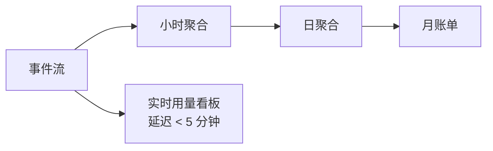

# 第 32 章 计量、账单与 SLO

> 计量是收入的源头，SLO 是承诺的边界。两者都必须可测量、可解释、可对账。

## 32.1 计量事件

| 字段 | 说明 |
|---|---|
| `event_id` | 唯一，幂等去重 |
| `request_id` / `task_id` | 关联 |
| `tenant_id` / `project_id` / `key_id` | 归属 |
| `model` / `version` | 计费对象 |
| `input_tokens` / `output_tokens` / `cached_tokens` | LLM |
| `images` / `resolution` / `quality` | 图像 |
| `video_seconds` / `resolution` / `audio` | 视频 |
| `status` | success / error / canceled |
| `occurred_at` | 事件时间 |
| `source` | gateway / engine / task |

事件只追加，不修改。迟到事件按 `occurred_at` 归入对应账期，跨期要标记。

## 32.2 Token 计量的三个口径

| 口径 | 来源 | 用途 |
|---|---|---|
| 引擎 usage | 引擎返回 | 权威（与计费一致） |
| 分词器估算 | 本地 tokenizer | 预检、限流 |
| 网关计数 | 流式 chunk | 兜底（引擎未返回时） |

差异处理：

- 以引擎 `usage` 为准；缺失时用网关计数，并标记 `estimated=true`。
- 预检用分词器估算，允许 ±5% 误差；超过则拒绝或截断。
- 流式中断时，按已生成 chunk 计数，不能按请求的 `max_tokens` 计费。

## 32.3 计费口径

| 场景 | 计费 | 说明 |
|---|---|---|
| 正常完成 | 输入 + 输出 + 缓存 | 按实际 |
| 流式中断（平台原因） | 按已生成 | 不收未生成部分 |
| 流式中断（客户断开） | 按已生成 | 已消耗算力 |
| 审核拒绝（输入） | 0 | 不产生算力或极少 |
| 审核拒绝（输出） | 0 或成本价 | 需合同约定 |
| 任务失败（平台） | 0 | 全额退 |
| 任务取消（未开始） | 0 | 全额退 |
| 任务取消（执行中） | 按已消耗 | 卡时/秒数 |
| 缓存命中 | 折扣价 | 通常为输入价 10%~25% |

## 32.4 聚合与出账



| 层 | 延迟 | 用途 |
|---|---|---|
| 实时 | 秒~分钟 | 限额、看板 |
| 小时 | 小时 | 异常检测 |
| 日 | T+1 | 对账 |
| 月 | T+1 | 发票 |

账单要能下钻到 `request_id`，否则客户争议时无法解释。

## 32.5 发票与调整

| 项 | 做法 |
|---|---|
| 账期 | 自然月，UTC+8 |
| 发票 | 按合同类型（增值税专票/普票） |
| 调整 | 用 credit note，不修改历史账单 |
| 退款 | 走财务流程，计量系统只记录 |
| 争议 | 30 天内，提供证据包 |

## 32.6 SLO 定义

| SLO | 定义 | 测量点 | 目标（示例） |
|---|---|---|---|
| 可用性 | 成功请求 / 总请求（排除 4xx） | 网关 | 99.9% |
| TTFT p99 | 首 token 延迟 | 网关 | ≤ 900ms |
| TPOT p99 | 每输出 token 延迟 | 引擎 | ≤ 60ms |
| 成功率 | 2xx / 总请求 | 网关 | ≥ 99.5% |
| 任务完成率 | succeeded / (succeeded+failed) | 任务系统 | ≥ 99% |
| 任务排队时长 | 创建到开始执行 | 任务系统 | 按档位承诺 |

关键：**测量点要统一**。网关测的 TTFT 包含网络，引擎测的不包含；对外承诺用网关口径。

## 32.7 错误预算与赔付

```
月错误预算 = (1 − SLO) × 总请求数
```

- 预算消耗 50% 时预警，80% 时冻结非必要变更。
- 赔付按合同（如可用性 < 99.9% 赔 10% 月费），要有上限。
- 排除项要写明：客户侧错误、计划内维护（提前通知）、不可抗力。

## 32.8 状态页

| 组件 | 状态粒度 |
|---|---|
| API 网关 | 可用/降级/故障 |
| 各模型 | 按模型 |
| 任务系统 | 队列延迟 |
| 控制台 | 可用性 |

状态页要自动更新，不能靠人工。事故时先更新状态页，再对外沟通。

## 本章结论

- 计量以引擎 usage 为准，网关计数兜底，事件只追加。
- 计费口径要覆盖失败、取消、审核拒绝、缓存命中四类边界。
- SLO 的测量点必须统一，对外用网关口径。
- 错误预算要驱动变更冻结，不只是报表。

## 决策点（结合自身情况）

1. 缓存命中折扣定多少？
2. 审核拒绝（输出）是否计费？
3. SLO 目标是否对外承诺，还是只做内部目标？
