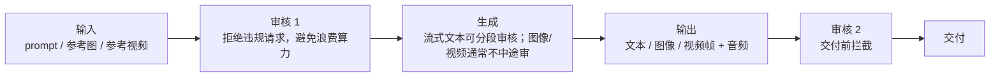

# 第 33 章 内容安全与多模态审核

> 审核是 MaaS 的准入成本，不是可选项。它必须在管线里，且不能因为"影响体验"而降级放行。

## 33.1 三端审核



| 端 | 时机 | 失败处理 |
|---|---|---|
| 输入 | 请求进入 | 422，不计费 |
| 输出 | 生成后、交付前 | 422/任务失败，退款 |
| 参考素材 | 上传后 | 拒绝上传或标记 |

## 33.2 分模态管线

| 模态 | 方法 | 延迟预算 | 成本特征 |
|---|---|---|---|
| 文本 | 分类模型 + 关键词 | < 50ms | 低 |
| 图像 | 图像分类 + OCR + 人脸 | 200ms~1s | 中 |
| 视频 | 抽帧（1fps 或场景）+ 音频 ASR + 分类 | 分钟级 | 高（可能占生成成本 10%~20%） |
| 多模态输入 | 上述组合 | 视大小 | 高 |

视频审核要和生成并行：生成一段、审一段，不要等全片生成完再抽帧，否则总时长翻倍。

## 33.3 策略引擎

```
输入：内容 + 租户 + 场景 + 模型
规则：类别 → 阈值 → 动作
动作：allow / review / block / mask
```

| 类别 | 动作（示例） |
|---|---|
| 色情 | block |
| 暴力 | block / review |
| 政治敏感 | block |
| 未成年人 | block（生成）/ review（理解） |
| 人脸/肖像 | review（需授权证明） |
| 版权风格 | review |
| 提示注入 | block（系统提示泄露） |

阈值要可配置，且变更要审计。不同租户可以有不同策略（企业客户可加严，不能放宽到违规）。

## 33.4 误杀与申诉

| 问题 | 处理 |
|---|---|
| 误杀率高 | 提供申诉通道，人工复审 |
| 复审时效 | 承诺 4 小时（工作时间） |
| 白名单 | 仅对可信企业客户，且记录 |
| 批量误杀 | 暂停该规则，回归测试后恢复 |

误杀率要作为指标监控，否则会悄悄流失客户。

## 33.5 特殊策略

| 场景 | 要求 |
|---|---|
| 未成年人 | 年龄识别 + 限制生成类型 |
| 人脸 | 上传需授权声明；生成人脸需额外审核 |
| 版权 | 风格/角色库；投诉下架流程 |
| 政治 | 关键词 + 模型分类 + 人工 |
| 医疗/法律建议 | 免责声明 + 限制 |

## 33.6 审核与计费

〔建议〕**输入违规不计费；输出违规不计费但记录；重复违规限流或封禁。**
理由：客户不为"被拒绝的服务"付费，但平台要能识别恶意刷量。

## 33.7 日志与报告

| 项 | 要求 |
|---|---|
| 审核记录 | 内容哈希、类别、动作、模型版本、时间 |
| 原文留存 | 默认不存；违规样本可存（脱敏） |
| 统计 | 按类别/租户/模型 |
| 监管报告 | 按主管部门要求导出 |

审核日志本身也是敏感数据，访问要审计。

## 33.8 本章结论

- 三端审核缺一不可，输入审核还能省算力。
- 视频审核要与生成并行，否则总时长翻倍。
- 策略要可配置、可审计，误杀率要监控。
- 违规不计费，但恶意行为要限流。

## 决策点（结合自身情况）

1. 审核是自建还是采购？涉及数据出境与成本。
2. 视频审核抽帧率（1fps / 场景切换）？
3. 人工复审团队规模与时效承诺。
