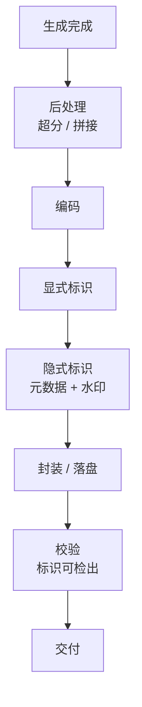

# 第 34 章 生成内容标识与水印

> 标识要写进文件字节，不是加在页面上。客户下载后转存、转发、二次编辑，标识仍应存在。

## 34.1 两类标识

| 类型 | 感知方式 | 载体 | 可否关闭 |
|---|---|---|---|
| 显式 | 人眼可见 | 画面角标、文字提示、片头片尾 | 可有条件关闭 |
| 隐式 | 不可见/不易察觉 | 文件元数据、数字水印 | 不可关闭 |

依据：《人工智能生成合成内容标识办法》自 2025 年 9 月 1 日起施行〔核验〕，
配套强制性国家标准同步实施〔核验〕。具体条款以官方文本为准。

## 34.2 显式标识

| 模态 | 位置 | 样式 |
|---|---|---|
| 图像 | 右下角或底部 | 半透明文字"AI 生成" + 可选标识图 |
| 视频 | 全程角标 + 片尾提示 | 角标不遮挡主体 |
| 文本 | 响应头/元数据/首尾提示 | 由产品决定 |
| 音频 | 片头/片尾提示音或语音 | 可选 |

实现要求：

1. **在编码阶段写入**，不是前端叠加。
2. **位置与透明度可配置**，但默认值要满足监管要求。
3. 视频角标要**贯穿全片**，不能只在开头几秒。
4. 关闭显式标识需要 `allow_explicit_mark=false` 权限 + 合同 + 审计日志。

## 34.3 隐式标识

三层，建议全做：

| 层 | 方式 | 抗攻击性 |
|---|---|---|
| 文件元数据 | EXIF/XMP/容器 metadata | 弱（易被剥离） |
| 内容凭证 | C2PA 类签名清单〔核验〕 | 中（可验证来源） |
| 数字水印 | 频域/空域水印 | 强（抗压缩/裁剪） |

只做元数据等于没做：社交平台一转存就丢了。数字水印要选经过攻击测试的方案。

## 34.4 写入点



顺序不能反：先标识再编码，编码会破坏水印；先编码再标识，元数据可能写不进去。

## 34.5 抗攻击测试

| 攻击 | 方法 | 通过标准 |
|---|---|---|
| JPEG 重压缩 | 质量 60/80/95 | 水印仍可检出 |
| 缩放 | 0.5x / 2x | 可检出 |
| 裁剪 | 中心 50% | 可检出（或部分） |
| 截图 | 屏幕截图 | 可检出 |
| 转码 | H.264 → H.265 | 可检出 |
| 格式转换 | PNG → WebP | 元数据可能丢失，水印仍在 |
| 加滤镜 | 亮度/对比度 | 可检出 |

测试结果要形成报告，作为备案材料的一部分。

## 34.6 客户关闭显式标识

| 条件 | 要求 |
|---|---|
| 合同条款 | 明确客户的标识义务 |
| 资质审核 | 企业实名、用途说明 |
| 开关权限 | 仅 Owner 可开，需二次确认 |
| 日志 | 提供对象、时间、内容 ID、用途，留存 ≥ 6 个月〔核验〕 |
| 抽检 | 定期抽查关闭标识的客户是否自行标识 |
| 违约 | 发现未标识，暂停权限 |

隐式标识**永远不能关闭**。

## 34.7 校验工具

提供一个独立工具（API + CLI）：

```
POST /v1/marks/verify  (file)
→ { explicit: true, implicit: {metadata: true, watermark: true, confidence: 0.98} }
```

用途：

- 客户自查。
- 平台抽检。
- 监管检查。
- 事故取证。

## 34.8 失败处理

| 失败 | 处理 |
|---|---|
| 水印写入失败 | **阻断交付**，任务失败并告警 |
| 元数据写入失败 | 阻断或降级（需评估） |
| 校验不通过 | 阻断，重试一次 |
| 工具不可用 | 阻断（合规红线） |

不能"先交付，后补标识"，因为产物已经流出去了。

## 本章结论

- 显式 + 隐式都要做，隐式不能关闭。
- 写入点在编码阶段，顺序不能反。
- 抗攻击测试是备案材料的一部分。
- 标识失败必须阻断交付。

## 决策点（结合自身情况）

1. 数字水印自研还是采购？自研要投入算法团队。
2. 视频角标样式与位置，是否需要客户定制？
3. 校验工具是否对外开放？
