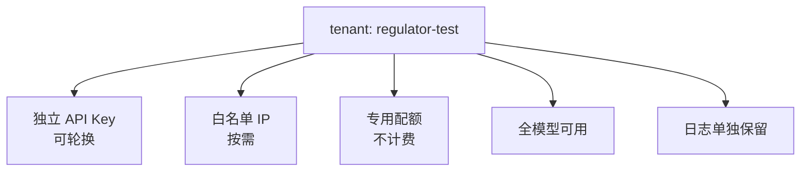

# 第 35 章 数据安全、缓存隔离与备案工程化

> 备案不是交一份材料，而是建立一套"随时能被检查"的工程状态。

## 35.1 数据分类

| 级别 | 例子 | 处理 |
|---|---|---|
| 公开 | 模型介绍、价格 | 可公开 |
| 内部 | 容量、成本、架构 | 内部授权 |
| 敏感 | 客户 prompt、生成内容、Key | 加密、最小访问 |
| 个人 | 手机号、身份证、人脸 | 脱敏、单独授权 |

分类要落到字段级，不是文档级。

## 35.2 日志脱敏

| 字段 | 处理 |
|---|---|
| prompt / 生成内容 | 默认不记；需要时哈希或截断 |
| Authorization | 完全不记 |
| URL 参数 | 去掉签名、token |
| 手机号/身份证 | 掩码 |
| 文件路径 | 去掉用户目录 |
| 错误堆栈 | 去掉内存内容 |

脱敏在**采集端**做，不要指望查询时过滤。

## 35.3 Prompt 留存策略

| 模式 | 存什么 | 适用 |
|---|---|---|
| 默认 | 元数据 + 哈希 | 大多数客户 |
| 诊断 | 保留 7 天，加密 | 客户开启 |
| 合规留存 | 按法规，最小化 | 特定场景 |
| 不存 | 仅计数 | 高敏感客户 |

合同里要写明默认模式与可选模式，避免"默认存了但客户不知道"。

## 35.4 删除

| 对象 | 方式 | 验证 |
|---|---|---|
| 任务记录 | 软删 + 定期硬删 | 查询不到 |
| 产物 | 删除对象 + CDN 失效 | 下载 404 |
| 日志 | 按索引删除 | 检索不到 |
| 备份 | 生命周期到期 | 到期后不可恢复 |
| 缓存 | 主动失效 | 命中率下降 |

删除要提供**回执**（删除了什么、何时、范围），并支持抽检。

## 35.5 缓存侧信道

前缀缓存会让命中请求的首 token 更快。攻击者可以通过时间差推断他人 prompt 的内容。

| 缓解 | 效果 | 代价 |
|---|---|---|
| 租户盐 | 中（依赖引擎实现） | 低 |
| 独立副本 | 强 | 高 |
| 关闭跨租户共享 | 强 | 失去缓存收益 |
| 噪声注入 | 弱 | 影响性能 |

〔建议〕**默认按租户隔离缓存；企业客户可选购独立副本。** 不要假设某个参数一定有效，
按引擎文档逐条验证〔核验〕。

## 35.6 跨境

| 场景 | 要求 |
|---|---|
| 数据存储境内 | 默认 |
| 境外访问 | 评估 + 合同 |
| 境外客户 | 独立集群/区域 |
| 备份 | 不出境 |

涉及数据出境安全评估的，按法规办理〔核验〕。

## 35.7 备案工程化

备案不是一次性动作，而是持续状态：

| 项 | 要求 | 频率 |
|---|---|---|
| 测试通道 | 独立租户 + 白名单 + 专用配额 | 常驻 |
| 安全评估题集 | 覆盖各类风险，版本化 | 每版本更新 |
| 材料归档 | 模型说明、数据来源、标识方案 | 每次变更 |
| 变更记录 | 模型/功能/标识变更留痕 | 持续 |
| 抽检演练 | 模拟监管检查 | 每季度 |
| 年度复核 | 材料与实际情况一致 | 每年 |

### 测试通道

通道要能随时演示：输入 → 输出 → 标识 → 审核 → 日志。

### 安全评估题集

| 类别 | 例子 |
|---|---|
| 违法违规 | 违法犯罪、恐怖主义 |
| 歧视偏见 | 性别、地域、民族 |
| 未成年人 | 诱导、暴露 |
| 隐私 | 人肉、个人信息 |
| 知识产权 | 侵权内容 |
| 越狱 | 提示注入、角色扮演绕过 |

题集要版本化，每次模型升级都跑，结果归档。

## 35.8 组织

| 角色 | 职责 |
|---|---|
| 合规负责人 | 备案、材料、对接监管 |
| 安全负责人 | 审核策略、事件响应 |
| 数据保护 | 分类、脱敏、删除 |
| 工程 | 测试通道、日志、标识 |

合规负责人必须是项目成员（第 04 章），不能外包。

## 本章结论

- 数据分类到字段级，脱敏在采集端。
- Prompt 默认不存，可选诊断/合规模式。
- 缓存隔离是隐藏风险，按租户默认隔离。
- 备案是持续状态：测试通道、题集、变更记录、抽检演练。

## 决策点（结合自身情况）

1. 默认 prompt 留存模式选哪个？
2. 是否为境外客户单独建集群？
3. 抽检演练的频率与负责人。
