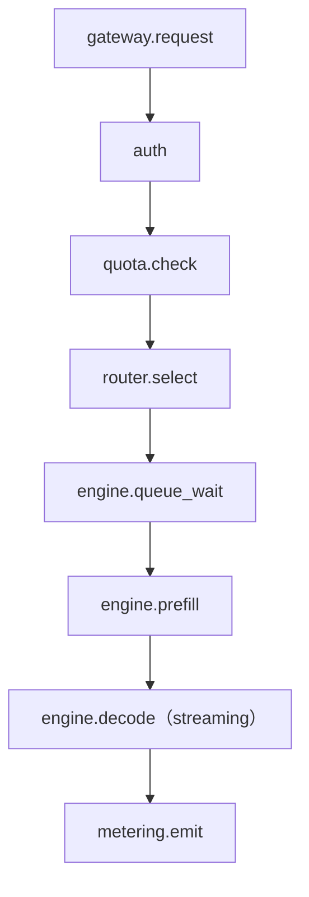
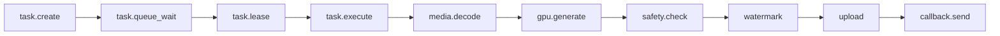

# 第 36 章 可观测体系与指标字典

> 可观测不是"多埋点"，而是"出了问题能在五分钟内定位到层"。

## 36.1 四层指标

| 层 | 核心指标 | 回答 |
|---|---|---|
| 基础设施 | GPU 温度/功耗/ECC/XID、IB 误码、磁盘、网络 | 硬件健康吗 |
| 引擎 | 队列深度、KV 使用率、前缀命中率、batch 大小、prefill/decode 耗时 | 引擎跑得好吗 |
| 服务 | QPS、TTFT、TPOT、错误率、超时率 | 服务达标吗 |
| 业务 | 用量、收入、租户活跃、任务完成率、成本 | 生意健康吗 |

## 36.2 每个服务的黄金信号

| 信号 | LLM | 任务系统 | 网关 |
|---|---|---|---|
| 延迟 | TTFT/TPOT | 排队/执行时长 | 端到端 |
| 流量 | token/s、并发 | 任务/分钟 | 请求/秒 |
| 错误 | 5xx、生成失败 | 失败率、重试率 | 4xx/5xx |
| 饱和度 | KV 使用率、队列 | 队列深度、worker 数 | 连接数 |

## 36.3 追踪

一个请求的 span 树：

异步任务：

采样策略：正常请求 1%~5%，错误请求 100%，慢请求 100%。

## 36.4 日志

| 项 | 要求 |
|---|---|
| 格式 | JSON 结构化 |
| 必带 | `request_id`、`tenant_id`、`model`、`status`、`latency_ms` |
| 内容 | 默认不记 prompt/产物 |
| 级别 | ERROR 要有可操作信息，不要只写"failed" |
| 保留 | 热 7 天，冷 ≥ 6 个月〔核验〕 |

## 36.5 面板

| 面板 | 受众 | 内容 |
|---|---|---|
| 平台总览 | 值班 | 集群健康、错误率、容量 |
| 模型健康 | 平台/模型 | 每模型 QPS、TTFT、错误、缓存命中 |
| 租户视图 | 客户成功 | 该客户用量、限额、错误 |
| 成本 | 财务/负责人 | 卡时、单位成本、毛利 |
| 合规 | 合规 | 审核拦截、标识、审计 |

## 36.6 告警

原则：**按症状告警，不按原因告警。**

| 告警 | 类型 | 阈值（示例） |
|---|---|---|
| 可用性错误预算燃烧 | SLO | 1 小时燃烧率 > 14.4 |
| TTFT p99 超阈值 | SLO | 5 分钟 > 900ms |
| 队列深度持续高 | 容量 | 10 分钟 > 100 |
| KV 使用率 > 95% | 饱和 | 5 分钟 |
| XID 79 | 硬件 | 立即 |
| 任务失败率 > 5% | 业务 | 10 分钟 |
| 回调失败率 > 10% | 业务 | 15 分钟 |
| 计费流水延迟 > 10 分钟 | 收入 | 立即 |

避免"每个指标一条告警"，会产生告警疲劳。

## 36.7 基数控制

`tenant_id`、`request_id` 是高基数标签，不能直接进 Prometheus label。

| 数据 | 处理 |
|---|---|
| request_id | 只进日志/追踪，不进指标 |
| tenant_id | 只对 Top N 租户打标，其余聚合 |
| model | 可打标（数量有限） |
| error_code | 可打标（有限枚举） |

## 36.8 本章结论

- 四层指标缺一不可，否则定位不到层。
- 追踪要覆盖排队、prefill、decode 三段。
- 告警按症状（SLO）而非原因。
- 高基数标签不能进指标系统。

## 决策点（结合自身情况）

1. 追踪采样率与存储成本。
2. 租户级指标保留多少 Top N？
3. 是否自建可观测平台，还是用托管服务？
