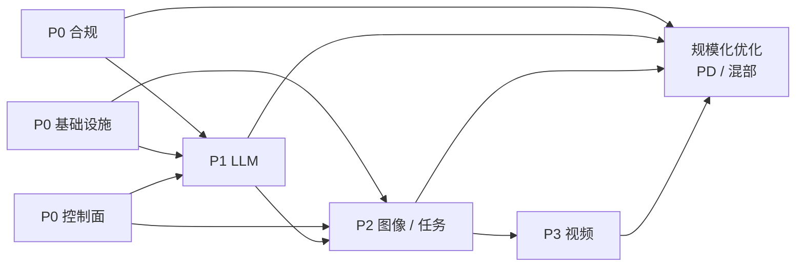

# 第 38 章 路线图：四阶段与验收标准

> 顺序比速度重要。合规与计量必须在前，PD 分离与混部必须往后放。

## 38.1 排序原则

1. **合规先启动**：周期以月计，不能等产品做完。
2. **控制面先于数据面**：否则每加一个模态都要改计费。
3. **LLM 先于图像，图像先于视频**：成熟度递减，成本方差递增。
4. **优化最后做**：PD 分离、混部、KV 分层都要有压测证据。

## 38.2 P0：底座与合规（第 0~2 月）

| 交付物 | 验收 | 不做什么 |
|---|---|---|
| 合规路径确认（备案类型、材料清单） | 有书面结论与时间表 | 不写法律意见 |
| 集群与网络（最小可用） | 节点验收通过，NCCL 基线入库 | 不追求千卡 |
| 控制面骨架（租户、目录、配额、计量） | 能创建租户/模型/Key，能出用量 | 不做复杂计费 |
| 网关（鉴权、限流、路由 v0） | 单模型可调用，429 正确 | 不做缓存路由 |
| 监控与日志 | request_id 贯穿，四层指标可见 | 不做精细归因 |
| 标识/审核服务接口 | 接口可用，能跑通样例 | 不做全模态 |

**退出条件**：一个内部租户能通过 API 调用一个模型，用量可查，日志可追。

## 38.3 P1：LLM 最小闭环（第 2~4 月）

| 交付物 | 验收 |
|---|---|
| OpenAI 兼容 API（chat/models） | 通过兼容性测试集 |
| 流式 SSE | 网关/客户端均无缓冲问题 |
| 配额与限流（TPM/并发） | 超限返回 429 + Retry-After |
| 计量与账单（按量） | 账单可下钻到 request_id |
| 审核（文本） | 输入/输出拦截有效 |
| 标识（文本） | 元数据/提示可检出 |
| 灰度与回滚 | 5 分钟内切回 |
| 首个付费客户 | 签约 + 实际出账 |

**退出条件**：一个外部客户连续使用 2 周，账单无争议，SLO 达标。

## 38.4 P2：图像与任务系统（第 4~7 月）

| 交付物 | 验收 |
|---|---|
| 任务系统（状态机、租约、重试） | 杀 worker 后任务自动恢复 |
| 回调（签名、重试、重放） | 断网 1 小时后恢复投递 |
| 图像 API（同步 + 异步） | 30 秒内同步，超过走任务 |
| 预扣与退款 | 失败全额退，账实一致 |
| 图像审核 + 标识 | 抽检通过 |
| 队列与容量（张/小时） | 压测达到规格 80% |

**退出条件**：图像任务在实例被 kill、节点被 drain 的情况下仍能完成并正确计费。

## 38.5 P3：视频与规模化（第 7~12 月）

| 交付物 | 验收 |
|---|---|
| 视频任务 API | 5 秒/720p 端到端可交付 |
| 分段生成 + 拼接 | 抢占后只重算当前段 |
| 视频审核（抽帧 + 音频） | 审核延迟可接受 |
| 视频标识 | 抗压缩/转码测试通过 |
| 容量模型（秒/小时） | 能预测排队时长 |
| PD/KV 评估 | 有 A/B 数据，决定做或不做 |
| 混部（借还） | 收回不影响在线 SLO |

**退出条件**：视频业务可对外售卖，单位成本可核算，抢占不丢任务。

## 38.6 依赖关系

注意：P2 的任务系统是 P1 的"异步化"延伸，不是从零开始；P1 的计量/账本要能直接支持 P2。

## 38.7 里程碑

| 里程碑 | 时间 | 判据 |
|---|---|---|
| M1 内部可用 | 第 2 月 | 内部租户可调用 |
| M2 首个付费（LLM） | 第 4 月 | 签约 + 出账 |
| M3 图像 GA | 第 7 月 | 任务可靠 + 计费准确 |
| M4 视频 Beta | 第 10 月 | 邀请制 + 交付完整 |
| M5 规模化 | 第 12 月 | 成本模型稳定 + 混部可控 |

## 38.8 不做什么（同样重要）

| 不做 | 原因 |
|---|---|
| 首版做 PD 分离 | 没有流量证据，增加故障面 |
| 首版做多集群 | 控制面复杂度翻倍 |
| 首版做 LoRA 动态加载 | 抖动与隔离风险 |
| 首版做承诺吞吐 | 容量会被锁死 |
| 首版做自研调度器 | 成熟方案够用 |
| 首版做全模态 | 质量与合规都难保证 |

## 本章结论

- 合规与控制面先行，LLM 先于图像，图像先于视频。
- 每个阶段都有明确退出条件，不满足不进入下一阶段。
- "不做什么"清单要跟"做什么"一样明确。
- 优化（PD/混部）必须等到有流量与压测数据。

## 决策点（结合自身情况）

1. 时间表是否按 12 个月排？取决于团队规模。
2. 首个付费客户是 LLM 还是图像？会改变 P1/P2 顺序。
3. 视频 Beta 是否邀请制？建议是。
